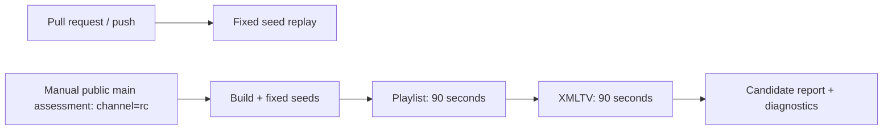

# Offline parser fuzz assessment

The public repository has a standalone source release-candidate assessment for
the actual Android core parsers. It does not create an Android release, APK,
tag, signature or device-acceptance record. The existing signed preview,
production and stable procedures in [RELEASING.md](RELEASING.md) still apply.

## Targets and assertions

- **Playlist:** `M3uParser`, the vendored shared `Playlist` parser, Kodi DRM
  properties, URL resolution, HTTP headers and header-origin tracking. Accepted
  entries must have unique stable IDs, HTTP(S) addresses, valid DRM/header
  configurations and origin records without credentials, paths or queries.
- **XMLTV:** `XmltvParser`, the shared XMLTV record/time rules and gzip decoding.
  Accepted programmes must have channel IDs and positive durations. The fixed
  corpus includes invalid dates, excessive nesting, a forbidden DOCTYPE,
  truncated gzip and a valid compressed guide.

Both targets require deterministic results. Expected validation exceptions are
handled at their documented boundary; assertion failures and unexpected errors
fail the run. Positive controls ensure valid playlists and programmes are still
accepted. Jazzer instruments both `play.ott.nativeapp.core` and `play.ott.core`.
No parser is copied or replaced by a simplified implementation.

The build compiles selected production JVM source files directly. The production
shared-core JAR must match its existing manifest. The compiler, runtime and
Jazzer dependencies are pinned by version, byte count and SHA-256 in
`fuzz/dependencies.json`. Downloading dependencies is permitted during setup;
the shared runner isolates the target processes from the network.

## Cost and trigger policy



Only an explicit manual `channel=rc` assessment on the public default branch
starts mutation. There is no mutation on pushes, pull requests, schedules,
previews or betas. Each input is at most 16 KiB. The two targets have 90-second
budgets, a 1 GiB Java heap each, and the shared runner's 2 GiB RSS/process limits.
JDK 17 is sufficient; the harness does not require Android SDK, Gradle,
an emulator, ADB, playback, provider access or signing credentials.

Run the source assessment after merging the reviewed change:

```sh
gh workflow run fuzz-candidate.yml --repo open-ott-play/ottplay-android --ref main -f channel=rc
```

The shared workflow stores `fuzz-candidate-<attempt>` for 90 days and diagnostics
for 30 days. The candidate report binds the source SHA, repository, manifest
digest, run/attempt and measured engine execution counts. Its separate schema
cannot qualify a versioned release or replace phone/TV and signing checks.
The README badge links to workflow status, not a certification or proof of
hardware compatibility.

## Fixed replay and maintenance

Normal host CI executes the committed corpus without random mutation:

```sh
python3 fuzz/build.py replay
python3 -m unittest discover -s scripts/tests -p 'test_fuzz_contract.py' -v
```

The first command fetches hash-checked dependencies, compiles the production
sources and replays the fixed inputs. Subsequent builds reuse verified files in
`.fuzz-build/`. Contract tests require the standalone compiler and direct runtime
versions to match the app; update the lock and hashes with dependency changes.
Use the upstream Maven artifacts linked by their coordinates in the lock.

If an assessment fails, inspect its logs, minimize the input, fix the production
code, preserve the input as a regression seed and rerun the assessment on the
new reviewed source. The committed corpus uses synthetic public data. Never
commit provider credentials, personal playlists or device exports.

## Findings retained as regressions

The first source RC assessment found a Unicode-host normalization case where an
imported playlist URL became unusable when parsed again for playback. The input
was reduced to `fuzz/corpus/playlist/unusable-idn-host`. URL resolution now
requires the canonical form to remain valid and unchanged under the same HTTP
parser. Unit tests also retain valid international domains, relative links and
the next valid channel after a rejected entry. The target invariant remains in
place; a fixed regression replay alone does not replace a fresh RC assessment.
