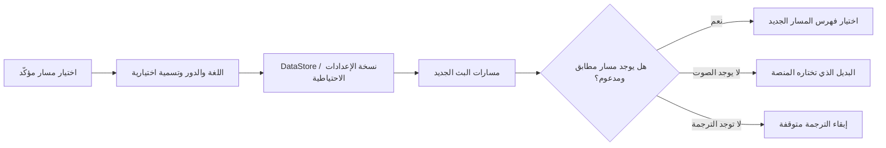

<div lang="ar" dir="rtl">

# تفضيلات الصوت والترجمة المحفوظة

<!-- language-navigation:start -->
<p dir="ltr">
<a href="TRACK-PREFERENCES.md" lang="en" dir="ltr">English</a> · <a href="TRACK-PREFERENCES.ar.md" lang="ar" dir="rtl">العربية</a> · <a href="TRACK-PREFERENCES.bn.md" lang="bn" dir="ltr">বাংলা</a> · <a href="TRACK-PREFERENCES.cs.md" lang="cs" dir="ltr">Čeština</a> · <a href="TRACK-PREFERENCES.de.md" lang="de" dir="ltr">Deutsch</a> · <a href="TRACK-PREFERENCES.es.md" lang="es" dir="ltr">Español</a> · <a href="TRACK-PREFERENCES.fa.md" lang="fa" dir="rtl">فارسی</a> · <a href="TRACK-PREFERENCES.fr.md" lang="fr" dir="ltr">Français</a><br>
<a href="TRACK-PREFERENCES.he.md" lang="he" dir="rtl">עברית</a> · <a href="TRACK-PREFERENCES.hi.md" lang="hi" dir="ltr">हिन्दी</a> · <a href="TRACK-PREFERENCES.id.md" lang="id" dir="ltr">Bahasa Indonesia</a> · <a href="TRACK-PREFERENCES.it.md" lang="it" dir="ltr">Italiano</a> · <a href="TRACK-PREFERENCES.ja.md" lang="ja" dir="ltr">日本語</a> · <a href="TRACK-PREFERENCES.ko.md" lang="ko" dir="ltr">한국어</a> · <a href="TRACK-PREFERENCES.nl.md" lang="nl" dir="ltr">Nederlands</a> · <a href="TRACK-PREFERENCES.pl.md" lang="pl" dir="ltr">Polski</a><br>
<a href="TRACK-PREFERENCES.pt.md" lang="pt" dir="ltr">Português</a> · <a href="TRACK-PREFERENCES.ru.md" lang="ru" dir="ltr">Русский</a> · <a href="TRACK-PREFERENCES.th.md" lang="th" dir="ltr">ไทย</a> · <a href="TRACK-PREFERENCES.tr.md" lang="tr" dir="ltr">Türkçe</a> · <a href="TRACK-PREFERENCES.uk.md" lang="uk" dir="ltr">Українська</a> · <a href="TRACK-PREFERENCES.vi.md" lang="vi" dir="ltr">Tiếng Việt</a> · <a href="TRACK-PREFERENCES.zh-Hans.md" lang="zh-Hans" dir="ltr">简体中文</a> · <a href="TRACK-PREFERENCES.zh-Hant.md" lang="zh-Hant" dir="ltr">繁體中文</a>
</p>
<!-- language-navigation:end -->

[README](../README.md)

في مشغّل Android الأصلي، افتح **المزيد ← الصوت / الترجمة**. يُحفظ الاختيار المؤكّد حسب اللغة والدور، لا حسب فهرسه في ملف البيان. يمكن لقناة جديدة تغيير ترتيب المسارات دون تغيير اللغة المطلوبة. لا تُستخدم التسمية إلا عندما لا تكون للمسار لغة. وتظل المسارات التي لا تحتوي على لغة أو تسمية أو دور اختيارًا للبث الحالي فقط.

- يزيل **تلقائي** التفضيل المحدّد صراحةً ويعيد اختيار منصة Media3، بما في ذلك لغة الجهاز. كما أن تأكيد «تلقائي» يمسح تفضيلًا لغته غير موجودة في البث الحالي.
- يبقي **إيقاف** الترجمة معطّلة عند تبديل القنوات وإعادة التشغيل.
- إذا لم يكن الصوت المطلوب متاحًا، تختار Media3 بديلًا قابلًا للتشغيل. ويبقى التفضيل المحفوظ متاحًا للبث المطابق التالي.
- إذا لم تكن الترجمة المطلوبة متاحة، تظل الترجمة معطّلة. وتعود عندما يحتوي بث لاحق على اللغة والدور المطلوبين.
- تُضمَّن الاختيارات الصريحة في النسخ الاحتياطية للإعدادات. وتستخدم النسخ المنشأة قبل هذه الميزة الوضع التلقائي لكلا نوعَي المسارات. يرفض التحقّق عند الاستيراد التفضيلات غير الصالحة قبل الكتابة إلى خزينة المصادر أو الفهرس.

<div dir="ltr">



</div>

توفّر فهارس موارد Android الحالية ونافذة اختيار المسارات المترجمة في Media3 التسميات؛ لا تضيف هذه الميزة رسائل واجهة باللغة الإنجليزية وحدها. تطبّق النافذة الاختيار المؤكّد على وحدة التحكّم وتُصدر إجراءً للتطبيق؛ ويكتبه ViewModel ضمن نطاقه الخاص، لذا لا يؤدي إغلاق اللوحة إلى إلغاء الحفظ. تطبّق الخدمة التفضيلات المحفوظة. ولا تستبدل أحداث مفكّك الترميز التلقائية أي تفضيل محفوظ أبدًا.

يتقدّم الاختيار المؤقت لمسار بلا تسمية على غيره في عنصر الوسائط الحالي، حتى إن وصلت لاحقًا كتابة تفضيل أقدم أو تغيير غير مرتبط في الترجمة. يزيل اختيار «تلقائي» صراحةً أو اختيار مسار آخر هذا الاختيار المؤقت. وينتهي دائمًا عند الانتقال إلى عنصر وسائط آخر، حتى عندما يعلن البث التالي عن مجموعة مسارات مساوية. كما أن تحرير المشغّل يلغي مراقبة التفضيلات.

## التحقّق

<div dir="ltr">

```sh
./gradlew :app:testDebugUnitTest --tests '*TrackPreferencesTest' --tests '*TrackPreferencePlayerTest' --tests '*SettingsBackupPolicyTest' :app:assembleDebug
```

</div>

تغطّي الاختبارات إعادة ترتيب المسارات، وأدوار التعليق، واختفاء الترجمة وعودتها، والإيقاف/التلقائي، وتأخّر تأكيدات التفضيلات، والانتقال بين عناصر وسائط ذات مجموعات مسارات مساوية، وتحرير المشغّل، وتصدير الإعدادات ثم استيرادها، وعمليات الاستيراد غير الصالحة. على جهاز فعلي، اختر لغة للصوت وترجمة، ثم انتقل إلى بث بترتيب مسارات معكوس، وأعد تشغيل التطبيق، ثم جرّب بثًا لا يحتوي على تلك المسارات واختر «تلقائي». يظل اختبار التشغيل هذا على جهاز فعلي ضروريًا؛ لا تثبت اختبارات الوحدة صحة البيانات الوصفية لموفّر البث.

</div>
