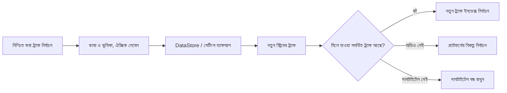

<div lang="bn" dir="ltr">

# অডিও ও সাবটাইটেলের স্থায়ী পছন্দ

<!-- language-navigation:start -->
<p dir="ltr">
<a href="TRACK-PREFERENCES.md" lang="en" dir="ltr">English</a> · <a href="TRACK-PREFERENCES.ar.md" lang="ar" dir="rtl">العربية</a> · <a href="TRACK-PREFERENCES.bn.md" lang="bn" dir="ltr">বাংলা</a> · <a href="TRACK-PREFERENCES.cs.md" lang="cs" dir="ltr">Čeština</a> · <a href="TRACK-PREFERENCES.de.md" lang="de" dir="ltr">Deutsch</a> · <a href="TRACK-PREFERENCES.es.md" lang="es" dir="ltr">Español</a> · <a href="TRACK-PREFERENCES.fa.md" lang="fa" dir="rtl">فارسی</a> · <a href="TRACK-PREFERENCES.fr.md" lang="fr" dir="ltr">Français</a><br>
<a href="TRACK-PREFERENCES.he.md" lang="he" dir="rtl">עברית</a> · <a href="TRACK-PREFERENCES.hi.md" lang="hi" dir="ltr">हिन्दी</a> · <a href="TRACK-PREFERENCES.id.md" lang="id" dir="ltr">Bahasa Indonesia</a> · <a href="TRACK-PREFERENCES.it.md" lang="it" dir="ltr">Italiano</a> · <a href="TRACK-PREFERENCES.ja.md" lang="ja" dir="ltr">日本語</a> · <a href="TRACK-PREFERENCES.ko.md" lang="ko" dir="ltr">한국어</a> · <a href="TRACK-PREFERENCES.nl.md" lang="nl" dir="ltr">Nederlands</a> · <a href="TRACK-PREFERENCES.pl.md" lang="pl" dir="ltr">Polski</a><br>
<a href="TRACK-PREFERENCES.pt.md" lang="pt" dir="ltr">Português</a> · <a href="TRACK-PREFERENCES.ru.md" lang="ru" dir="ltr">Русский</a> · <a href="TRACK-PREFERENCES.th.md" lang="th" dir="ltr">ไทย</a> · <a href="TRACK-PREFERENCES.tr.md" lang="tr" dir="ltr">Türkçe</a> · <a href="TRACK-PREFERENCES.uk.md" lang="uk" dir="ltr">Українська</a> · <a href="TRACK-PREFERENCES.vi.md" lang="vi" dir="ltr">Tiếng Việt</a> · <a href="TRACK-PREFERENCES.zh-Hans.md" lang="zh-Hans" dir="ltr">简体中文</a> · <a href="TRACK-PREFERENCES.zh-Hant.md" lang="zh-Hant" dir="ltr">繁體中文</a>
</p>
<!-- language-navigation:end -->

[README](../README.md)

নেটিভ Android প্লেয়ারে **আরও → অডিও / সাবটাইটেল** খুলুন। নিশ্চিত করা নির্বাচন ম্যানিফেস্টের ইনডেক্স দিয়ে নয়, ভাষা ও ভূমিকা দিয়ে সংরক্ষিত হয়। নতুন চ্যানেল অনুরোধ করা ভাষা না বদলিয়েই ট্র্যাকের ক্রম বদলাতে পারে। ট্র্যাকে ভাষা না থাকলেই কেবল লেবেল ব্যবহার করা হয়। যেসব ট্র্যাকে ভাষা, লেবেল বা ভূমিকা—কোনোটিই নেই, সেগুলোর নির্বাচন শুধু বর্তমান স্ট্রিমের জন্য থাকে।

- **স্বয়ংক্রিয়** স্পষ্টভাবে নির্ধারিত পছন্দ সরিয়ে Media3-এর প্ল্যাটফর্ম নির্বাচন ফিরিয়ে আনে, যার মধ্যে ডিভাইসের ভাষাও রয়েছে। স্বয়ংক্রিয় নিশ্চিত করলে বর্তমান স্ট্রিমে নেই এমন ভাষার পছন্দও মুছে যায়।
- **বন্ধ** চ্যানেল বদলানো ও পুনরায় চালু করার পরেও সাবটাইটেল নিষ্ক্রিয় রাখে।
- অনুরোধ করা অডিও না থাকলে Media3 চালানো যায় এমন বিকল্প বেছে নেয়। সংরক্ষিত পছন্দটি পরবর্তী মিলে যাওয়া স্ট্রিমের জন্য থেকে যায়।
- অনুরোধ করা সাবটাইটেল না থাকলে সাবটাইটেল নিষ্ক্রিয় থাকে। পরবর্তী কোনো স্ট্রিমে অনুরোধ করা ভাষা ও ভূমিকা থাকলে তা আবার ফিরে আসে।
- স্পষ্ট নির্বাচন সেটিংসের ব্যাকআপে অন্তর্ভুক্ত থাকে। এই সুবিধা আসার আগে তৈরি ব্যাকআপ উভয় ধরনের ট্র্যাকের জন্য স্বয়ংক্রিয় ব্যবহার করে। আমদানির যাচাই উৎস ভল্ট বা ক্যাটালগে লেখার আগেই ত্রুটিপূর্ণ গঠনের পছন্দ প্রত্যাখ্যান করে।



বিদ্যমান Android রিসোর্স ক্যাটালগ ও Media3-এর স্থানীয়কৃত ট্র্যাক ডায়ালগ থেকে লেবেল আসে; এই সুবিধা শুধু ইংরেজিতে থাকা কোনো UI বার্তা যোগ করে না। ডায়ালগ নিশ্চিত নির্বাচনটি কন্ট্রোলারে প্রয়োগ করে এবং একটি অ্যাপ অ্যাকশন পাঠায়; ViewModel নিজের স্কোপে সেটি লেখে, তাই প্যানেল বন্ধ করলেও স্থায়ীভাবে সংরক্ষণ বাতিল হয় না। সার্ভিস সংরক্ষিত পছন্দ প্রয়োগ করে। ডিকোডারের স্বয়ংক্রিয় ইভেন্ট কখনো সংরক্ষিত পছন্দের ওপর লেখে না।

লেবেলহীন ট্র্যাকের অস্থায়ী নির্বাচন বর্তমান মিডিয়া আইটেমের জন্য অগ্রাধিকার পায়, এমনকি পরে পুরোনো পছন্দের লেখা বা সাবটাইটেলের কোনো সম্পর্কহীন পরিবর্তন এলেও। স্পষ্টভাবে স্বয়ংক্রিয় বা অন্য ট্র্যাক নির্বাচন করলে এই অস্থায়ী নির্বাচন সরে যায়। মিডিয়া আইটেম পরিবর্তন হলে এটি সবসময় শেষ হয়, এমনকি পরবর্তী স্ট্রিম সমান ট্র্যাক গ্রুপ ঘোষণা করলেও। প্লেয়ার রিলিজ করলে পছন্দ পর্যবেক্ষণও বাতিল হয়।

## যাচাই

```sh
./gradlew :app:testDebugUnitTest --tests '*TrackPreferencesTest' --tests '*TrackPreferencePlayerTest' --tests '*SettingsBackupPolicyTest' :app:assembleDebug
```

পরীক্ষায় ট্র্যাকের নতুন ক্রম, ধারাভাষ্যের ভূমিকা, সাবটাইটেল হারিয়ে আবার ফিরে আসা, বন্ধ/স্বয়ংক্রিয়, দেরিতে আসা পছন্দের স্বীকৃতি, সমান ট্র্যাক গ্রুপের মিডিয়া আইটেম পরিবর্তন, প্লেয়ার রিলিজ, সেটিংস রপ্তানি করে আবার আমদানি এবং ত্রুটিপূর্ণ গঠনের আমদানি অন্তর্ভুক্ত। কোনো ডিভাইসে অডিও ভাষা ও সাবটাইটেল নির্বাচন করুন, বিপরীত ট্র্যাক ক্রমের স্ট্রিমে যান, অ্যাপ আবার চালু করুন, তারপর ওই ট্র্যাকগুলো ছাড়া একটি স্ট্রিম চেষ্টা করুন এবং স্বয়ংক্রিয় বেছে নিন। বাস্তব ডিভাইসে প্লেব্যাকের এই যাচাই এখনও প্রয়োজন; ইউনিট পরীক্ষা প্রমাণ করে না যে স্ট্রিম প্রদানকারীর মেটাডেটা সঠিক।

</div>
