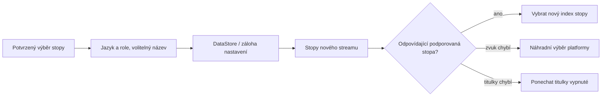

<div lang="cs" dir="ltr">

# Trvalé předvolby zvuku a titulků

<!-- language-navigation:start -->
<p dir="ltr">
<a href="TRACK-PREFERENCES.md" lang="en" dir="ltr">English</a> · <a href="TRACK-PREFERENCES.ar.md" lang="ar" dir="rtl">العربية</a> · <a href="TRACK-PREFERENCES.bn.md" lang="bn" dir="ltr">বাংলা</a> · <a href="TRACK-PREFERENCES.cs.md" lang="cs" dir="ltr">Čeština</a> · <a href="TRACK-PREFERENCES.de.md" lang="de" dir="ltr">Deutsch</a> · <a href="TRACK-PREFERENCES.es.md" lang="es" dir="ltr">Español</a> · <a href="TRACK-PREFERENCES.fa.md" lang="fa" dir="rtl">فارسی</a> · <a href="TRACK-PREFERENCES.fr.md" lang="fr" dir="ltr">Français</a><br>
<a href="TRACK-PREFERENCES.he.md" lang="he" dir="rtl">עברית</a> · <a href="TRACK-PREFERENCES.hi.md" lang="hi" dir="ltr">हिन्दी</a> · <a href="TRACK-PREFERENCES.id.md" lang="id" dir="ltr">Bahasa Indonesia</a> · <a href="TRACK-PREFERENCES.it.md" lang="it" dir="ltr">Italiano</a> · <a href="TRACK-PREFERENCES.ja.md" lang="ja" dir="ltr">日本語</a> · <a href="TRACK-PREFERENCES.ko.md" lang="ko" dir="ltr">한국어</a> · <a href="TRACK-PREFERENCES.nl.md" lang="nl" dir="ltr">Nederlands</a> · <a href="TRACK-PREFERENCES.pl.md" lang="pl" dir="ltr">Polski</a><br>
<a href="TRACK-PREFERENCES.pt.md" lang="pt" dir="ltr">Português</a> · <a href="TRACK-PREFERENCES.ru.md" lang="ru" dir="ltr">Русский</a> · <a href="TRACK-PREFERENCES.th.md" lang="th" dir="ltr">ไทย</a> · <a href="TRACK-PREFERENCES.tr.md" lang="tr" dir="ltr">Türkçe</a> · <a href="TRACK-PREFERENCES.uk.md" lang="uk" dir="ltr">Українська</a> · <a href="TRACK-PREFERENCES.vi.md" lang="vi" dir="ltr">Tiếng Việt</a> · <a href="TRACK-PREFERENCES.zh-Hans.md" lang="zh-Hans" dir="ltr">简体中文</a> · <a href="TRACK-PREFERENCES.zh-Hant.md" lang="zh-Hant" dir="ltr">繁體中文</a>
</p>
<!-- language-navigation:end -->

[README](../README.md)

V nativním přehrávači pro Android otevřete **Více → Zvuk / Titulky**. Potvrzený výběr se ukládá podle jazyka a role stopy, nikoli podle jejího indexu v manifestu. Nový kanál může změnit pořadí stop, aniž by se změnil požadovaný jazyk. Název stopy se používá jen tehdy, když stopa nemá uveden jazyk. Stopy bez jazyka, názvu i role lze zvolit pouze pro aktuální stream.

- **Auto** odstraní výslovnou předvolbu a obnoví výběr platformy Media3 včetně jazyka zařízení. Potvrzení Auto smaže i předvolbu, jejíž jazyk v aktuálním streamu chybí.
- **Vypnuto** ponechá titulky vypnuté i při přepínání kanálů a restartování.
- Pokud požadovaný zvuk chybí, Media3 zvolí přehratelnou náhradu. Uložená předvolba zůstane k dispozici pro další odpovídající stream.
- Pokud požadované titulky chybí, zůstanou vypnuté. Vrátí se, až některý další stream nabídne požadovaný jazyk a roli.
- Výslovné volby jsou součástí záloh nastavení. Zálohy vytvořené před zavedením této funkce používají Auto pro oba typy stop. Kontrola importu odmítne nesprávně vytvořené předvolby ještě před zápisem do úložiště zdrojů nebo katalogu.



Popisky poskytují stávající katalogy prostředků Androidu a lokalizovaný dialog stop Media3; tato funkce nepřidává zprávy rozhraní dostupné pouze anglicky. Dialog použije potvrzený výběr v kontroléru a vyšle akci aplikace. ViewModel jej zapíše ve svém vlastním rozsahu, takže zavření panelu ukládání nezruší. Služba používá uložené předvolby. Automatické události dekodéru nikdy nepřepíší uloženou předvolbu.

Dočasný výběr stopy bez názvu má přednost pro aktuální mediální položku, i když později dorazí starší zápis předvolby nebo nesouvisející změna titulků. Výslovná volba Auto nebo jiné stopy tento dočasný výběr odstraní. Přechod na jinou mediální položku jej vždy ukončí, i když další stream nabízí shodnou skupinu stop. Uvolnění přehrávače také zruší sledování předvoleb.

## Ověření

```sh
./gradlew :app:testDebugUnitTest --tests '*TrackPreferencesTest' --tests '*TrackPreferencePlayerTest' --tests '*SettingsBackupPolicyTest' :app:assembleDebug
```

Testy pokrývají změnu pořadí stop, role komentáře, mizející a vracející se titulky, Vypnuto/Auto, opožděná potvrzení předvoleb, přechody mezi položkami se shodnými skupinami, uvolnění přehrávače, export a zpětný import nastavení i chybné importy. Na zařízení vyberte jazyk zvuku a titulky, přejděte na stream s obráceným pořadím stop, restartujte aplikaci a poté zkuste stream bez těchto stop a zvolte Auto. Tato kontrola přehrávání na fyzickém zařízení zůstává nutná; jednotkové testy nedokazují správnost metadat poskytovatele streamu.

</div>
