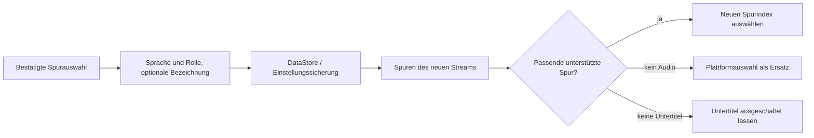

<div lang="de" dir="ltr">

# Dauerhafte Einstellungen für Audio und Untertitel

<!-- language-navigation:start -->
<p dir="ltr">
<a href="TRACK-PREFERENCES.md" lang="en" dir="ltr">English</a> · <a href="TRACK-PREFERENCES.ar.md" lang="ar" dir="rtl">العربية</a> · <a href="TRACK-PREFERENCES.bn.md" lang="bn" dir="ltr">বাংলা</a> · <a href="TRACK-PREFERENCES.cs.md" lang="cs" dir="ltr">Čeština</a> · <a href="TRACK-PREFERENCES.de.md" lang="de" dir="ltr">Deutsch</a> · <a href="TRACK-PREFERENCES.es.md" lang="es" dir="ltr">Español</a> · <a href="TRACK-PREFERENCES.fa.md" lang="fa" dir="rtl">فارسی</a> · <a href="TRACK-PREFERENCES.fr.md" lang="fr" dir="ltr">Français</a><br>
<a href="TRACK-PREFERENCES.he.md" lang="he" dir="rtl">עברית</a> · <a href="TRACK-PREFERENCES.hi.md" lang="hi" dir="ltr">हिन्दी</a> · <a href="TRACK-PREFERENCES.id.md" lang="id" dir="ltr">Bahasa Indonesia</a> · <a href="TRACK-PREFERENCES.it.md" lang="it" dir="ltr">Italiano</a> · <a href="TRACK-PREFERENCES.ja.md" lang="ja" dir="ltr">日本語</a> · <a href="TRACK-PREFERENCES.ko.md" lang="ko" dir="ltr">한국어</a> · <a href="TRACK-PREFERENCES.nl.md" lang="nl" dir="ltr">Nederlands</a> · <a href="TRACK-PREFERENCES.pl.md" lang="pl" dir="ltr">Polski</a><br>
<a href="TRACK-PREFERENCES.pt.md" lang="pt" dir="ltr">Português</a> · <a href="TRACK-PREFERENCES.ru.md" lang="ru" dir="ltr">Русский</a> · <a href="TRACK-PREFERENCES.th.md" lang="th" dir="ltr">ไทย</a> · <a href="TRACK-PREFERENCES.tr.md" lang="tr" dir="ltr">Türkçe</a> · <a href="TRACK-PREFERENCES.uk.md" lang="uk" dir="ltr">Українська</a> · <a href="TRACK-PREFERENCES.vi.md" lang="vi" dir="ltr">Tiếng Việt</a> · <a href="TRACK-PREFERENCES.zh-Hans.md" lang="zh-Hans" dir="ltr">简体中文</a> · <a href="TRACK-PREFERENCES.zh-Hant.md" lang="zh-Hant" dir="ltr">繁體中文</a>
</p>
<!-- language-navigation:end -->

[README](../README.md)

Öffnen Sie im nativen Android-Player **Mehr → Audio / Untertitel**. Eine bestätigte Auswahl wird anhand ihrer Sprache und Rolle gespeichert, nicht anhand ihres Index im Manifest. Ein neuer Kanal kann die Spuren anders anordnen, ohne die gewünschte Sprache zu ändern. Eine Bezeichnung wird nur verwendet, wenn die Spur keine Sprachangabe hat. Spuren ohne Sprache, Bezeichnung oder Rolle bleiben eine Auswahl nur für den aktuellen Stream.

- **Auto** entfernt die ausdrückliche Einstellung und stellt die Plattformauswahl von Media3 einschließlich der Gerätesprache wieder her. Das Bestätigen von Auto löscht auch eine Einstellung, deren Sprache im aktuellen Stream fehlt.
- **Aus** lässt Untertitel auch nach Kanalwechseln und Neustarts deaktiviert.
- Fehlt das gewünschte Audio, wählt Media3 eine abspielbare Alternative. Die gespeicherte Einstellung bleibt für den nächsten passenden Stream erhalten.
- Fehlen die gewünschten Untertitel, bleiben sie deaktiviert. Sie kehren zurück, wenn ein späterer Stream die gewünschte Sprache und Rolle enthält.
- Ausdrückliche Auswahlen sind in Einstellungssicherungen enthalten. Sicherungen von vor dieser Funktion verwenden Auto für beide Spurtypen. Die Importprüfung weist fehlerhafte Einstellungen zurück, bevor sie den Quellenspeicher oder Katalog beschreibt.



Die vorhandenen Android-Ressourcenkataloge und der lokalisierte Spurdialog von Media3 liefern die Beschriftungen; diese Funktion ergänzt keine ausschließlich englischen UI-Meldungen. Der Dialog wendet die bestätigte Auswahl auf den Controller an und sendet eine App-Aktion. Das ViewModel schreibt sie in seinem eigenen Gültigkeitsbereich, sodass das Schließen des Bereichs die Speicherung nicht abbricht. Der Dienst wendet die gespeicherten Einstellungen an. Automatische Decoder-Ereignisse überschreiben niemals eine gespeicherte Einstellung.

Eine temporäre Auswahl einer unbeschrifteten Spur hat für das aktuelle Medienelement Vorrang, selbst wenn später ein älterer Schreibvorgang für Einstellungen oder eine unabhängige Untertiteländerung eintrifft. Die ausdrückliche Auswahl von Auto oder einer anderen Spur hebt diese temporäre Auswahl auf. Ein Wechsel des Medienelements beendet sie immer, auch wenn der nächste Stream eine gleichwertige Spurgruppe meldet. Beim Freigeben des Players wird auch die Beobachtung der Einstellungen beendet.

## Überprüfung

```sh
./gradlew :app:testDebugUnitTest --tests '*TrackPreferencesTest' --tests '*TrackPreferencePlayerTest' --tests '*SettingsBackupPolicyTest' :app:assembleDebug
```

Die Tests decken umsortierte Spuren, Kommentarrollen, fehlende und zurückkehrende Untertitel, Aus/Auto, verspätete Einstellungsbestätigungen, Medienwechsel mit gleichwertigen Spurgruppen, die Player-Freigabe, den Export und erneuten Import von Einstellungen sowie fehlerhafte Importe ab. Wählen Sie auf einem Gerät eine Audiosprache und Untertitel, wechseln Sie zu einem Stream mit umgekehrter Spurreihenfolge, starten Sie die App neu und testen Sie anschließend einen Stream ohne diese Spuren und wählen Auto. Diese Prüfung der Wiedergabe auf einem echten Gerät bleibt erforderlich; Unit-Tests beweisen nicht, dass die Metadaten eines Stream-Anbieters korrekt sind.

</div>
