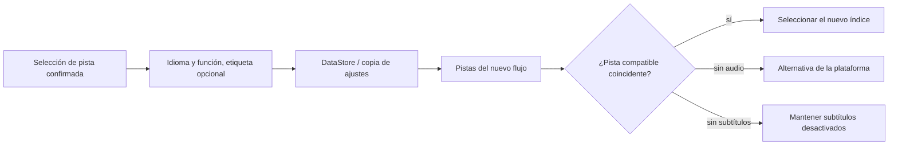

<div lang="es" dir="ltr">

# Preferencias persistentes de audio y subtítulos

<!-- language-navigation:start -->
<p dir="ltr">
<a href="TRACK-PREFERENCES.md" lang="en" dir="ltr">English</a> · <a href="TRACK-PREFERENCES.ar.md" lang="ar" dir="rtl">العربية</a> · <a href="TRACK-PREFERENCES.bn.md" lang="bn" dir="ltr">বাংলা</a> · <a href="TRACK-PREFERENCES.cs.md" lang="cs" dir="ltr">Čeština</a> · <a href="TRACK-PREFERENCES.de.md" lang="de" dir="ltr">Deutsch</a> · <a href="TRACK-PREFERENCES.es.md" lang="es" dir="ltr">Español</a> · <a href="TRACK-PREFERENCES.fa.md" lang="fa" dir="rtl">فارسی</a> · <a href="TRACK-PREFERENCES.fr.md" lang="fr" dir="ltr">Français</a><br>
<a href="TRACK-PREFERENCES.he.md" lang="he" dir="rtl">עברית</a> · <a href="TRACK-PREFERENCES.hi.md" lang="hi" dir="ltr">हिन्दी</a> · <a href="TRACK-PREFERENCES.id.md" lang="id" dir="ltr">Bahasa Indonesia</a> · <a href="TRACK-PREFERENCES.it.md" lang="it" dir="ltr">Italiano</a> · <a href="TRACK-PREFERENCES.ja.md" lang="ja" dir="ltr">日本語</a> · <a href="TRACK-PREFERENCES.ko.md" lang="ko" dir="ltr">한국어</a> · <a href="TRACK-PREFERENCES.nl.md" lang="nl" dir="ltr">Nederlands</a> · <a href="TRACK-PREFERENCES.pl.md" lang="pl" dir="ltr">Polski</a><br>
<a href="TRACK-PREFERENCES.pt.md" lang="pt" dir="ltr">Português</a> · <a href="TRACK-PREFERENCES.ru.md" lang="ru" dir="ltr">Русский</a> · <a href="TRACK-PREFERENCES.th.md" lang="th" dir="ltr">ไทย</a> · <a href="TRACK-PREFERENCES.tr.md" lang="tr" dir="ltr">Türkçe</a> · <a href="TRACK-PREFERENCES.uk.md" lang="uk" dir="ltr">Українська</a> · <a href="TRACK-PREFERENCES.vi.md" lang="vi" dir="ltr">Tiếng Việt</a> · <a href="TRACK-PREFERENCES.zh-Hans.md" lang="zh-Hans" dir="ltr">简体中文</a> · <a href="TRACK-PREFERENCES.zh-Hant.md" lang="zh-Hant" dir="ltr">繁體中文</a>
</p>
<!-- language-navigation:end -->

[README](../README.md)

En el reproductor nativo de Android, abra **Más → Audio / Subtítulos**. Una selección confirmada se guarda por su idioma y función, no por su índice en el manifiesto. Un canal nuevo puede reordenar las pistas sin cambiar el idioma solicitado. La etiqueta solo se usa cuando la pista no tiene idioma. Las pistas sin idioma, etiqueta ni función solo pueden seleccionarse para el flujo actual.

- **Auto** elimina la preferencia explícita y restablece la selección de la plataforma Media3, incluido el idioma del dispositivo. Confirmar Auto también elimina una preferencia cuyo idioma no está en el flujo actual.
- **Desactivado** mantiene los subtítulos deshabilitados al cambiar de canal y reiniciar.
- Si falta el audio solicitado, Media3 elige una alternativa reproducible. La preferencia guardada sigue disponible para el siguiente flujo compatible.
- Si faltan los subtítulos solicitados, permanecen deshabilitados. Vuelven cuando un flujo posterior contiene el idioma y la función solicitados.
- Las selecciones explícitas se incluyen en las copias de seguridad de ajustes. Las copias anteriores a esta función usan Auto para ambos tipos de pista. La validación de importación rechaza preferencias mal formadas antes de escribir en el almacén de fuentes o el catálogo.



Los catálogos de recursos existentes de Android y el diálogo de pistas localizado de Media3 proporcionan las etiquetas; esta función no añade mensajes de interfaz solo en inglés. El diálogo aplica la selección confirmada al controlador y emite una acción de la aplicación; el ViewModel la escribe en su propio ámbito, por lo que cerrar el panel no cancela la persistencia. El servicio aplica las preferencias guardadas. Los eventos automáticos del decodificador nunca sobrescriben una preferencia guardada.

La selección temporal de una pista sin etiqueta tiene prioridad para el elemento multimedia actual, incluso si después llega una escritura anterior de preferencias o un cambio de subtítulos independiente. Elegir explícitamente Auto u otra pista elimina esa selección temporal. Una transición de elemento multimedia siempre la hace caducar, incluso cuando el siguiente flujo anuncia un grupo de pistas equivalente. Liberar el reproductor también cancela la observación de preferencias.

## Verificación

```sh
./gradlew :app:testDebugUnitTest --tests '*TrackPreferencesTest' --tests '*TrackPreferencePlayerTest' --tests '*SettingsBackupPolicyTest' :app:assembleDebug
```

Las pruebas cubren pistas reordenadas, funciones de comentarios, subtítulos que desaparecen y vuelven, Desactivado/Auto, confirmaciones tardías de preferencias, transiciones multimedia con grupos equivalentes, liberación del reproductor, exportación y reimportación de ajustes e importaciones mal formadas. En un dispositivo, seleccione un idioma de audio y subtítulos, pase a un flujo con el orden de pistas invertido, reinicie la aplicación y pruebe después un flujo sin esas pistas, eligiendo Auto. Esta comprobación de reproducción en un dispositivo sigue siendo necesaria; las pruebas unitarias no demuestran que los metadatos del proveedor sean correctos.

</div>
