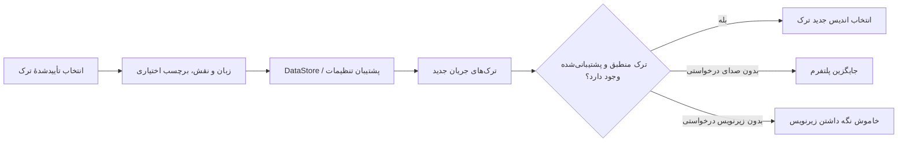

<div lang="fa" dir="rtl">

# تنظیمات ماندگار صدا و زیرنویس

<!-- language-navigation:start -->
<p dir="ltr">
<a href="TRACK-PREFERENCES.md" lang="en" dir="ltr">English</a> · <a href="TRACK-PREFERENCES.ar.md" lang="ar" dir="rtl">العربية</a> · <a href="TRACK-PREFERENCES.bn.md" lang="bn" dir="ltr">বাংলা</a> · <a href="TRACK-PREFERENCES.cs.md" lang="cs" dir="ltr">Čeština</a> · <a href="TRACK-PREFERENCES.de.md" lang="de" dir="ltr">Deutsch</a> · <a href="TRACK-PREFERENCES.es.md" lang="es" dir="ltr">Español</a> · <a href="TRACK-PREFERENCES.fa.md" lang="fa" dir="rtl">فارسی</a> · <a href="TRACK-PREFERENCES.fr.md" lang="fr" dir="ltr">Français</a><br>
<a href="TRACK-PREFERENCES.he.md" lang="he" dir="rtl">עברית</a> · <a href="TRACK-PREFERENCES.hi.md" lang="hi" dir="ltr">हिन्दी</a> · <a href="TRACK-PREFERENCES.id.md" lang="id" dir="ltr">Bahasa Indonesia</a> · <a href="TRACK-PREFERENCES.it.md" lang="it" dir="ltr">Italiano</a> · <a href="TRACK-PREFERENCES.ja.md" lang="ja" dir="ltr">日本語</a> · <a href="TRACK-PREFERENCES.ko.md" lang="ko" dir="ltr">한국어</a> · <a href="TRACK-PREFERENCES.nl.md" lang="nl" dir="ltr">Nederlands</a> · <a href="TRACK-PREFERENCES.pl.md" lang="pl" dir="ltr">Polski</a><br>
<a href="TRACK-PREFERENCES.pt.md" lang="pt" dir="ltr">Português</a> · <a href="TRACK-PREFERENCES.ru.md" lang="ru" dir="ltr">Русский</a> · <a href="TRACK-PREFERENCES.th.md" lang="th" dir="ltr">ไทย</a> · <a href="TRACK-PREFERENCES.tr.md" lang="tr" dir="ltr">Türkçe</a> · <a href="TRACK-PREFERENCES.uk.md" lang="uk" dir="ltr">Українська</a> · <a href="TRACK-PREFERENCES.vi.md" lang="vi" dir="ltr">Tiếng Việt</a> · <a href="TRACK-PREFERENCES.zh-Hans.md" lang="zh-Hans" dir="ltr">简体中文</a> · <a href="TRACK-PREFERENCES.zh-Hant.md" lang="zh-Hant" dir="ltr">繁體中文</a>
</p>
<!-- language-navigation:end -->

[README](../README.md)

در پخش‌کنندهٔ بومی Android، **بیشتر ← صدا / زیرنویس** را باز کنید. انتخاب تأییدشده بر اساس زبان و نقش ذخیره می‌شود، نه اندیس آن در مانیفست. کانال جدید می‌تواند ترتیب ترک‌ها را بدون تغییر زبان درخواستی عوض کند. برچسب فقط زمانی استفاده می‌شود که ترک فاقد زبان باشد. ترک‌هایی که زبان، برچسب و نقش ندارند، فقط برای جریان فعلی انتخاب می‌شوند.

- **خودکار** ترجیح صریح را حذف می‌کند و انتخاب پلتفرم Media3، از جمله زبان دستگاه، را برمی‌گرداند. تأیید «خودکار» همچنین ترجیحی را که زبانش در جریان فعلی موجود نیست پاک می‌کند.
- **خاموش** زیرنویس را پس از تغییر کانال و راه‌اندازی مجدد نیز غیرفعال نگه می‌دارد.
- اگر صدای درخواستی موجود نباشد، Media3 یک جایگزین قابل پخش انتخاب می‌کند. ترجیح ذخیره‌شده برای جریان منطبق بعدی حفظ می‌شود.
- اگر زیرنویس درخواستی موجود نباشد، زیرنویس غیرفعال می‌ماند. وقتی جریان بعدی شامل زبان و نقش درخواستی باشد، زیرنویس دوباره فعال می‌شود.
- انتخاب‌های صریح در نسخه‌های پشتیبان تنظیمات قرار می‌گیرند. نسخه‌های پشتیبانی که پیش از این قابلیت ساخته شده‌اند برای هر دو نوع ترک از حالت خودکار استفاده می‌کنند. اعتبارسنجی واردسازی، ترجیحات با ساختار نامعتبر را پیش از نوشتن در مخزن منابع یا فهرست رد می‌کند.

<div dir="ltr">



</div>

برچسب‌ها از فهرست‌های منابع موجود Android و پنجرهٔ بومی‌سازی‌شدهٔ انتخاب ترک در Media3 تأمین می‌شوند؛ این قابلیت پیام رابط کاربری صرفاً انگلیسی اضافه نمی‌کند. پنجره، انتخاب تأییدشده را روی کنترل‌کننده اعمال و یک اکشن برنامه صادر می‌کند؛ ViewModel آن را در دامنهٔ خودش می‌نویسد، بنابراین بستن پنل ذخیره‌سازی را لغو نمی‌کند. سرویس ترجیحات ذخیره‌شده را اعمال می‌کند. رویدادهای خودکار رمزگشا هرگز ترجیح ذخیره‌شده را بازنویسی نمی‌کنند.

انتخاب موقت یک ترک بدون برچسب برای آیتم رسانهٔ فعلی اولویت دارد، حتی اگر بعداً نوشتن یک ترجیح قدیمی‌تر یا تغییری نامرتبط در زیرنویس برسد. انتخاب صریح «خودکار» یا ترک دیگر، این انتخاب موقت را حذف می‌کند. گذار به آیتم رسانهٔ دیگر همیشه آن را منقضی می‌کند، حتی وقتی جریان بعدی یک گروه ترک برابر اعلام کند. آزادسازی پخش‌کننده نیز مشاهدهٔ ترجیحات را لغو می‌کند.

## راستی‌آزمایی

<div dir="ltr">

```sh
./gradlew :app:testDebugUnitTest --tests '*TrackPreferencesTest' --tests '*TrackPreferencePlayerTest' --tests '*SettingsBackupPolicyTest' :app:assembleDebug
```

</div>

آزمون‌ها ترتیب جدید ترک‌ها، نقش‌های تفسیر صوتی، ناپدید شدن و بازگشت زیرنویس‌ها، خاموش/خودکار، تأییدهای دیرهنگام ترجیحات، گذارهای رسانه‌ای با گروه‌های ترک برابر، آزادسازی پخش‌کننده، صادرسازی و واردسازی دوبارهٔ تنظیمات و واردسازی‌های نامعتبر را پوشش می‌دهند. روی یک دستگاه، زبان صدا و زیرنویس را انتخاب کنید، به جریانی با ترتیب معکوس ترک‌ها بروید، برنامه را دوباره راه‌اندازی کنید، سپس جریانی بدون آن ترک‌ها را امتحان و «خودکار» را انتخاب کنید. این بررسی پخش روی دستگاه واقعی همچنان لازم است؛ آزمون‌های واحد درستی فرادادهٔ ارائه‌دهندهٔ جریان را اثبات نمی‌کنند.

</div>
