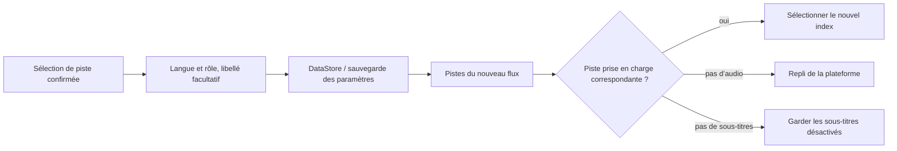

<div lang="fr" dir="ltr">

# Préférences audio et sous-titres persistantes

<!-- language-navigation:start -->
<p dir="ltr">
<a href="TRACK-PREFERENCES.md" lang="en" dir="ltr">English</a> · <a href="TRACK-PREFERENCES.ar.md" lang="ar" dir="rtl">العربية</a> · <a href="TRACK-PREFERENCES.bn.md" lang="bn" dir="ltr">বাংলা</a> · <a href="TRACK-PREFERENCES.cs.md" lang="cs" dir="ltr">Čeština</a> · <a href="TRACK-PREFERENCES.de.md" lang="de" dir="ltr">Deutsch</a> · <a href="TRACK-PREFERENCES.es.md" lang="es" dir="ltr">Español</a> · <a href="TRACK-PREFERENCES.fa.md" lang="fa" dir="rtl">فارسی</a> · <a href="TRACK-PREFERENCES.fr.md" lang="fr" dir="ltr">Français</a><br>
<a href="TRACK-PREFERENCES.he.md" lang="he" dir="rtl">עברית</a> · <a href="TRACK-PREFERENCES.hi.md" lang="hi" dir="ltr">हिन्दी</a> · <a href="TRACK-PREFERENCES.id.md" lang="id" dir="ltr">Bahasa Indonesia</a> · <a href="TRACK-PREFERENCES.it.md" lang="it" dir="ltr">Italiano</a> · <a href="TRACK-PREFERENCES.ja.md" lang="ja" dir="ltr">日本語</a> · <a href="TRACK-PREFERENCES.ko.md" lang="ko" dir="ltr">한국어</a> · <a href="TRACK-PREFERENCES.nl.md" lang="nl" dir="ltr">Nederlands</a> · <a href="TRACK-PREFERENCES.pl.md" lang="pl" dir="ltr">Polski</a><br>
<a href="TRACK-PREFERENCES.pt.md" lang="pt" dir="ltr">Português</a> · <a href="TRACK-PREFERENCES.ru.md" lang="ru" dir="ltr">Русский</a> · <a href="TRACK-PREFERENCES.th.md" lang="th" dir="ltr">ไทย</a> · <a href="TRACK-PREFERENCES.tr.md" lang="tr" dir="ltr">Türkçe</a> · <a href="TRACK-PREFERENCES.uk.md" lang="uk" dir="ltr">Українська</a> · <a href="TRACK-PREFERENCES.vi.md" lang="vi" dir="ltr">Tiếng Việt</a> · <a href="TRACK-PREFERENCES.zh-Hans.md" lang="zh-Hans" dir="ltr">简体中文</a> · <a href="TRACK-PREFERENCES.zh-Hant.md" lang="zh-Hant" dir="ltr">繁體中文</a>
</p>
<!-- language-navigation:end -->

[README](../README.md)

Dans le lecteur Android natif, ouvrez **Plus → Audio / Sous-titres**. Une sélection confirmée est enregistrée selon sa langue et son rôle, pas selon son index dans le manifeste. Une nouvelle chaîne peut réordonner les pistes sans modifier la langue demandée. Le libellé n’est utilisé que si la piste ne possède pas de langue. Les pistes sans langue, libellé ni rôle ne sont sélectionnées que pour le flux actuel.

- **Auto** supprime la préférence explicite et rétablit la sélection de la plateforme Media3, y compris la langue de l’appareil. Confirmer Auto efface aussi une préférence dont la langue est absente du flux actuel.
- **Désactivé** conserve les sous-titres désactivés lors des changements de chaîne et des redémarrages.
- Si l’audio demandé est absent, Media3 choisit une solution de repli lisible. La préférence enregistrée reste disponible pour le prochain flux correspondant.
- Si les sous-titres demandés sont absents, ils restent désactivés. Ils reviennent lorsqu’un flux ultérieur contient la langue et le rôle demandés.
- Les choix explicites sont inclus dans les sauvegardes des paramètres. Les sauvegardes antérieures à cette fonction utilisent Auto pour les deux types de pistes. La validation de l’import rejette les préférences mal formées avant toute écriture dans le stockage des sources ou le catalogue.



Les catalogues de ressources Android existants et la boîte de dialogue de pistes localisée de Media3 fournissent les libellés ; cette fonction n’ajoute aucun message d’interface uniquement en anglais. Le dialogue applique le choix confirmé au contrôleur et émet une action de l’application ; le ViewModel l’écrit dans sa propre portée, donc fermer le panneau n’annule pas la persistance. Le service applique les préférences enregistrées. Les événements automatiques du décodeur n’écrasent jamais une préférence enregistrée.

La sélection temporaire d’une piste sans libellé est prioritaire pour l’élément multimédia actuel, même si une ancienne écriture de préférence ou un changement de sous-titres indépendant arrive ensuite. Choisir explicitement Auto ou une autre piste supprime cette sélection temporaire. Tout changement d’élément multimédia y met fin, même si le flux suivant annonce un groupe de pistes équivalent. La libération du lecteur annule également l’observation des préférences.

## Vérification

```sh
./gradlew :app:testDebugUnitTest --tests '*TrackPreferencesTest' --tests '*TrackPreferencePlayerTest' --tests '*SettingsBackupPolicyTest' :app:assembleDebug
```

Les tests couvrent le réordonnancement des pistes, les rôles de commentaire, la disparition et le retour des sous-titres, Désactivé/Auto, les confirmations tardives des préférences, les transitions entre éléments avec des groupes équivalents, la libération du lecteur, l’export puis le réimport des paramètres et les imports mal formés. Sur un appareil, sélectionnez une langue audio et des sous-titres, passez à un flux dont l’ordre des pistes est inversé, redémarrez l’application, puis essayez un flux sans ces pistes et choisissez Auto. Cette vérification de lecture sur appareil reste nécessaire ; les tests unitaires ne prouvent pas l’exactitude des métadonnées du fournisseur de flux.

</div>
