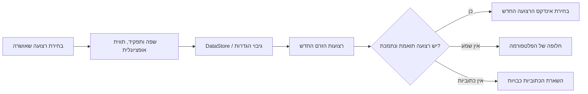

<div lang="he" dir="rtl">

# העדפות שמע וכתוביות שנשמרות לאורך זמן

<!-- language-navigation:start -->
<p dir="ltr">
<a href="TRACK-PREFERENCES.md" lang="en" dir="ltr">English</a> · <a href="TRACK-PREFERENCES.ar.md" lang="ar" dir="rtl">العربية</a> · <a href="TRACK-PREFERENCES.bn.md" lang="bn" dir="ltr">বাংলা</a> · <a href="TRACK-PREFERENCES.cs.md" lang="cs" dir="ltr">Čeština</a> · <a href="TRACK-PREFERENCES.de.md" lang="de" dir="ltr">Deutsch</a> · <a href="TRACK-PREFERENCES.es.md" lang="es" dir="ltr">Español</a> · <a href="TRACK-PREFERENCES.fa.md" lang="fa" dir="rtl">فارسی</a> · <a href="TRACK-PREFERENCES.fr.md" lang="fr" dir="ltr">Français</a><br>
<a href="TRACK-PREFERENCES.he.md" lang="he" dir="rtl">עברית</a> · <a href="TRACK-PREFERENCES.hi.md" lang="hi" dir="ltr">हिन्दी</a> · <a href="TRACK-PREFERENCES.id.md" lang="id" dir="ltr">Bahasa Indonesia</a> · <a href="TRACK-PREFERENCES.it.md" lang="it" dir="ltr">Italiano</a> · <a href="TRACK-PREFERENCES.ja.md" lang="ja" dir="ltr">日本語</a> · <a href="TRACK-PREFERENCES.ko.md" lang="ko" dir="ltr">한국어</a> · <a href="TRACK-PREFERENCES.nl.md" lang="nl" dir="ltr">Nederlands</a> · <a href="TRACK-PREFERENCES.pl.md" lang="pl" dir="ltr">Polski</a><br>
<a href="TRACK-PREFERENCES.pt.md" lang="pt" dir="ltr">Português</a> · <a href="TRACK-PREFERENCES.ru.md" lang="ru" dir="ltr">Русский</a> · <a href="TRACK-PREFERENCES.th.md" lang="th" dir="ltr">ไทย</a> · <a href="TRACK-PREFERENCES.tr.md" lang="tr" dir="ltr">Türkçe</a> · <a href="TRACK-PREFERENCES.uk.md" lang="uk" dir="ltr">Українська</a> · <a href="TRACK-PREFERENCES.vi.md" lang="vi" dir="ltr">Tiếng Việt</a> · <a href="TRACK-PREFERENCES.zh-Hans.md" lang="zh-Hans" dir="ltr">简体中文</a> · <a href="TRACK-PREFERENCES.zh-Hant.md" lang="zh-Hant" dir="ltr">繁體中文</a>
</p>
<!-- language-navigation:end -->

[README](../README.md)

בנגן Android המקורי, פתחו את **עוד ← שמע / כתוביות**. בחירה שאושרה נשמרת לפי השפה והתפקיד שלה, ולא לפי האינדקס שלה במניפסט. ערוץ חדש יכול לשנות את סדר הרצועות בלי לשנות את השפה המבוקשת. תווית משמשת רק כאשר לרצועה אין שפה. רצועות שאין להן שפה, תווית או תפקיד נשארות בחירה עבור הזרם הנוכחי בלבד.

- **אוטומטי** מסיר את ההעדפה המפורשת ומשחזר את הבחירה של פלטפורמת Media3, לרבות שפת המכשיר. אישור אוטומטי מנקה גם העדפה שהשפה שלה חסרה בזרם הנוכחי.
- **כבוי** משאיר את הכתוביות מושבתות גם במעבר בין ערוצים ובהפעלה מחדש.
- אם השמע המבוקש חסר, Media3 בוחר חלופה שניתן לנגן. ההעדפה השמורה נשארת זמינה לזרם התואם הבא.
- אם הכתוביות המבוקשות חסרות, הכתוביות נשארות מושבתות. הן חוזרות כאשר זרם מאוחר יותר מכיל את השפה ואת התפקיד המבוקשים.
- בחירות מפורשות נכללות בגיבויי ההגדרות. גיבויים שנוצרו לפני הוספת התכונה משתמשים באוטומטי עבור שני סוגי הרצועות. אימות הייבוא דוחה העדפות בעלות מבנה שגוי לפני הכתיבה לכספת המקורות או לקטלוג.

<div dir="ltr">



</div>

קטלוגי המשאבים הקיימים של Android ותיבת הדו־שיח המתורגמת לבחירת רצועות של Media3 מספקים את התוויות; התכונה אינה מוסיפה הודעות ממשק באנגלית בלבד. תיבת הדו־שיח מחילה את הבחירה שאושרה על הבקר ומפיקה פעולת יישום; ViewModel כותב אותה בתחום הפעולה שלו, ולכן סגירת החלונית אינה מבטלת את השמירה. השירות מחיל את ההעדפות השמורות. אירועים אוטומטיים של המפענח לעולם אינם דורסים העדפה שמורה.

בחירה זמנית ברצועה ללא תווית מקבלת עדיפות עבור פריט המדיה הנוכחי, גם אם מאוחר יותר מגיעה כתיבה של העדפה ישנה יותר או שינוי לא קשור בכתוביות. בחירה מפורשת באוטומטי או ברצועה אחרת מסירה את הבחירה הזמנית. מעבר לפריט מדיה אחר תמיד מבטל אותה, גם כאשר הזרם הבא מצהיר על קבוצת רצועות שווה. שחרור הנגן מבטל גם את המעקב אחר ההעדפות.

## אימות

<div dir="ltr">

```sh
./gradlew :app:testDebugUnitTest --tests '*TrackPreferencesTest' --tests '*TrackPreferencePlayerTest' --tests '*SettingsBackupPolicyTest' :app:assembleDebug
```

</div>

הבדיקות מכסות שינוי סדר רצועות, תפקידי פרשנות, היעלמות וחזרה של כתוביות, כבוי/אוטומטי, אישורי העדפות שמגיעים באיחור, מעברים בין פריטי מדיה בעלי קבוצות רצועות שוות, שחרור נגן, ייצוא וייבוא חוזר של הגדרות וייבוא בעל מבנה שגוי. במכשיר, בחרו שפת שמע וכתוביות, עברו לזרם שסדר הרצועות בו הפוך, הפעילו מחדש את היישום, ואז נסו זרם ללא הרצועות האלה ובחרו באוטומטי. בדיקת הניגון הזאת במכשיר פיזי עדיין נחוצה; בדיקות יחידה אינן מוכיחות שהמטא־נתונים של ספק הזרם נכונים.

</div>
