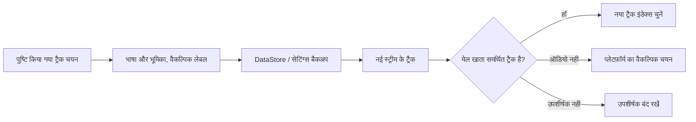

<div lang="hi" dir="ltr">

# ऑडियो और उपशीर्षक की स्थायी प्राथमिकताएँ

<!-- language-navigation:start -->
<p dir="ltr">
<a href="TRACK-PREFERENCES.md" lang="en" dir="ltr">English</a> · <a href="TRACK-PREFERENCES.ar.md" lang="ar" dir="rtl">العربية</a> · <a href="TRACK-PREFERENCES.bn.md" lang="bn" dir="ltr">বাংলা</a> · <a href="TRACK-PREFERENCES.cs.md" lang="cs" dir="ltr">Čeština</a> · <a href="TRACK-PREFERENCES.de.md" lang="de" dir="ltr">Deutsch</a> · <a href="TRACK-PREFERENCES.es.md" lang="es" dir="ltr">Español</a> · <a href="TRACK-PREFERENCES.fa.md" lang="fa" dir="rtl">فارسی</a> · <a href="TRACK-PREFERENCES.fr.md" lang="fr" dir="ltr">Français</a><br>
<a href="TRACK-PREFERENCES.he.md" lang="he" dir="rtl">עברית</a> · <a href="TRACK-PREFERENCES.hi.md" lang="hi" dir="ltr">हिन्दी</a> · <a href="TRACK-PREFERENCES.id.md" lang="id" dir="ltr">Bahasa Indonesia</a> · <a href="TRACK-PREFERENCES.it.md" lang="it" dir="ltr">Italiano</a> · <a href="TRACK-PREFERENCES.ja.md" lang="ja" dir="ltr">日本語</a> · <a href="TRACK-PREFERENCES.ko.md" lang="ko" dir="ltr">한국어</a> · <a href="TRACK-PREFERENCES.nl.md" lang="nl" dir="ltr">Nederlands</a> · <a href="TRACK-PREFERENCES.pl.md" lang="pl" dir="ltr">Polski</a><br>
<a href="TRACK-PREFERENCES.pt.md" lang="pt" dir="ltr">Português</a> · <a href="TRACK-PREFERENCES.ru.md" lang="ru" dir="ltr">Русский</a> · <a href="TRACK-PREFERENCES.th.md" lang="th" dir="ltr">ไทย</a> · <a href="TRACK-PREFERENCES.tr.md" lang="tr" dir="ltr">Türkçe</a> · <a href="TRACK-PREFERENCES.uk.md" lang="uk" dir="ltr">Українська</a> · <a href="TRACK-PREFERENCES.vi.md" lang="vi" dir="ltr">Tiếng Việt</a> · <a href="TRACK-PREFERENCES.zh-Hans.md" lang="zh-Hans" dir="ltr">简体中文</a> · <a href="TRACK-PREFERENCES.zh-Hant.md" lang="zh-Hant" dir="ltr">繁體中文</a>
</p>
<!-- language-navigation:end -->

[README](../README.md)

मूल Android प्लेयर में **अधिक → ऑडियो / उपशीर्षक** खोलें। पुष्टि किए गए चयन को उसकी भाषा और भूमिका के अनुसार सहेजा जाता है, मैनिफ़ेस्ट में उसके इंडेक्स के अनुसार नहीं। नया चैनल अनुरोधित भाषा बदले बिना ट्रैक का क्रम बदल सकता है। लेबल का उपयोग केवल तब होता है जब ट्रैक में भाषा नहीं होती। जिन ट्रैक में भाषा, लेबल या भूमिका में से कुछ भी नहीं होता, उनका चयन केवल वर्तमान स्ट्रीम के लिए रहता है।

- **स्वचालित** स्पष्ट रूप से सेट की गई प्राथमिकता हटाकर Media3 का प्लेटफ़ॉर्म चयन बहाल करता है, जिसमें डिवाइस की भाषा भी शामिल है। स्वचालित की पुष्टि करने से वह प्राथमिकता भी हट जाती है जिसकी भाषा वर्तमान स्ट्रीम में उपलब्ध नहीं है।
- **बंद** चैनल बदलने और दोबारा शुरू करने के बाद भी उपशीर्षकों को अक्षम रखता है।
- अनुरोधित ऑडियो उपलब्ध न होने पर Media3 चलाने योग्य वैकल्पिक ट्रैक चुनता है। सहेजी गई प्राथमिकता अगली मेल खाने वाली स्ट्रीम के लिए उपलब्ध रहती है।
- अनुरोधित उपशीर्षक उपलब्ध न होने पर उपशीर्षक अक्षम रहते हैं। बाद की किसी स्ट्रीम में अनुरोधित भाषा और भूमिका मिलने पर वे वापस आ जाते हैं।
- स्पष्ट चयन सेटिंग्स के बैकअप में शामिल होते हैं। इस सुविधा से पहले बनाए गए बैकअप दोनों ट्रैक प्रकारों के लिए स्वचालित का उपयोग करते हैं। आयात सत्यापन स्रोत वॉल्ट या कैटलॉग में लिखने से पहले गलत संरचना वाली प्राथमिकताओं को अस्वीकार कर देता है।



मौजूदा Android संसाधन कैटलॉग और Media3 का स्थानीयकृत ट्रैक संवाद लेबल प्रदान करते हैं; यह सुविधा केवल अंग्रेज़ी में उपलब्ध कोई UI संदेश नहीं जोड़ती। संवाद पुष्टि किए गए चयन को कंट्रोलर पर लागू करता है और ऐप ऐक्शन भेजता है; ViewModel उसे अपने स्कोप में लिखता है, इसलिए पैनल बंद करने से स्थायी रूप से सहेजना रद्द नहीं होता। सेवा सहेजी गई प्राथमिकताएँ लागू करती है। डिकोडर के स्वचालित इवेंट कभी किसी सहेजी गई प्राथमिकता को नहीं बदलते।

बिना लेबल वाले ट्रैक का अस्थायी चयन वर्तमान मीडिया आइटम के लिए प्राथमिकता रखता है, भले ही बाद में किसी पुरानी प्राथमिकता का लेखन या उपशीर्षक का कोई असंबंधित बदलाव पहुँचे। स्पष्ट रूप से स्वचालित या कोई अन्य ट्रैक चुनने से यह अस्थायी चयन हट जाता है। मीडिया आइटम बदलने पर यह हमेशा समाप्त हो जाता है, तब भी जब अगली स्ट्रीम बराबर ट्रैक समूह घोषित करे। प्लेयर को रिलीज़ करने से प्राथमिकताओं की निगरानी भी रद्द हो जाती है।

## सत्यापन

```sh
./gradlew :app:testDebugUnitTest --tests '*TrackPreferencesTest' --tests '*TrackPreferencePlayerTest' --tests '*SettingsBackupPolicyTest' :app:assembleDebug
```

परीक्षणों में ट्रैक का बदला क्रम, कमेंट्री भूमिकाएँ, गायब होकर लौटने वाले उपशीर्षक, बंद/स्वचालित, देर से आने वाली प्राथमिकता पुष्टियाँ, बराबर ट्रैक समूहों वाले मीडिया आइटमों के बीच बदलाव, प्लेयर रिलीज़, सेटिंग्स का निर्यात और दोबारा आयात, तथा गलत संरचना वाले आयात शामिल हैं। किसी डिवाइस पर ऑडियो भाषा और उपशीर्षक चुनें, ट्रैक के उलटे क्रम वाली स्ट्रीम पर जाएँ, ऐप दोबारा शुरू करें, फिर उन ट्रैक के बिना वाली स्ट्रीम आज़माएँ और स्वचालित चुनें। भौतिक डिवाइस पर प्लेबैक की यह जाँच अब भी आवश्यक है; यूनिट परीक्षण यह साबित नहीं करते कि स्ट्रीम प्रदाता का मेटाडेटा सही है।

</div>
