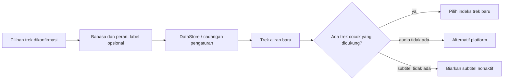

<div lang="id" dir="ltr">

# Preferensi audio dan subtitel yang tersimpan

<!-- language-navigation:start -->
<p dir="ltr">
<a href="TRACK-PREFERENCES.md" lang="en" dir="ltr">English</a> · <a href="TRACK-PREFERENCES.ar.md" lang="ar" dir="rtl">العربية</a> · <a href="TRACK-PREFERENCES.bn.md" lang="bn" dir="ltr">বাংলা</a> · <a href="TRACK-PREFERENCES.cs.md" lang="cs" dir="ltr">Čeština</a> · <a href="TRACK-PREFERENCES.de.md" lang="de" dir="ltr">Deutsch</a> · <a href="TRACK-PREFERENCES.es.md" lang="es" dir="ltr">Español</a> · <a href="TRACK-PREFERENCES.fa.md" lang="fa" dir="rtl">فارسی</a> · <a href="TRACK-PREFERENCES.fr.md" lang="fr" dir="ltr">Français</a><br>
<a href="TRACK-PREFERENCES.he.md" lang="he" dir="rtl">עברית</a> · <a href="TRACK-PREFERENCES.hi.md" lang="hi" dir="ltr">हिन्दी</a> · <a href="TRACK-PREFERENCES.id.md" lang="id" dir="ltr">Bahasa Indonesia</a> · <a href="TRACK-PREFERENCES.it.md" lang="it" dir="ltr">Italiano</a> · <a href="TRACK-PREFERENCES.ja.md" lang="ja" dir="ltr">日本語</a> · <a href="TRACK-PREFERENCES.ko.md" lang="ko" dir="ltr">한국어</a> · <a href="TRACK-PREFERENCES.nl.md" lang="nl" dir="ltr">Nederlands</a> · <a href="TRACK-PREFERENCES.pl.md" lang="pl" dir="ltr">Polski</a><br>
<a href="TRACK-PREFERENCES.pt.md" lang="pt" dir="ltr">Português</a> · <a href="TRACK-PREFERENCES.ru.md" lang="ru" dir="ltr">Русский</a> · <a href="TRACK-PREFERENCES.th.md" lang="th" dir="ltr">ไทย</a> · <a href="TRACK-PREFERENCES.tr.md" lang="tr" dir="ltr">Türkçe</a> · <a href="TRACK-PREFERENCES.uk.md" lang="uk" dir="ltr">Українська</a> · <a href="TRACK-PREFERENCES.vi.md" lang="vi" dir="ltr">Tiếng Việt</a> · <a href="TRACK-PREFERENCES.zh-Hans.md" lang="zh-Hans" dir="ltr">简体中文</a> · <a href="TRACK-PREFERENCES.zh-Hant.md" lang="zh-Hant" dir="ltr">繁體中文</a>
</p>
<!-- language-navigation:end -->

[README](../README.md)

Di pemutar Android native, buka **Lainnya → Audio / Subtitel**. Pilihan yang dikonfirmasi disimpan berdasarkan bahasa dan perannya, bukan indeks dalam manifes. Kanal baru dapat mengubah urutan trek tanpa mengubah bahasa yang diminta. Label hanya digunakan jika trek tidak memiliki bahasa. Trek tanpa bahasa, label, maupun peran hanya dapat dipilih untuk aliran saat ini.

- **Otomatis** menghapus preferensi eksplisit dan memulihkan pemilihan platform Media3, termasuk bahasa perangkat. Mengonfirmasi Otomatis juga menghapus preferensi yang bahasanya tidak ada dalam aliran saat ini.
- **Nonaktif** menjaga subtitel tetap dinonaktifkan saat berganti kanal dan memulai ulang.
- Jika audio yang diminta tidak tersedia, Media3 memilih alternatif yang dapat diputar. Preferensi yang tersimpan tetap tersedia untuk aliran berikutnya yang cocok.
- Jika subtitel yang diminta tidak tersedia, subtitel tetap dinonaktifkan. Subtitel kembali saat aliran berikutnya memuat bahasa dan peran yang diminta.
- Pilihan eksplisit disertakan dalam cadangan pengaturan. Cadangan yang dibuat sebelum fitur ini menggunakan Otomatis untuk kedua jenis trek. Validasi impor menolak preferensi yang tidak valid sebelum menulis ke penyimpanan sumber atau katalog.



Katalog sumber daya Android yang sudah ada dan dialog trek Media3 yang dilokalkan menyediakan label; fitur ini tidak menambahkan pesan antarmuka yang hanya berbahasa Inggris. Dialog menerapkan pilihan yang dikonfirmasi ke pengontrol dan mengirim tindakan aplikasi; ViewModel menulisnya dalam cakupannya sendiri, sehingga menutup panel tidak membatalkan penyimpanan. Layanan menerapkan preferensi tersimpan. Peristiwa dekoder otomatis tidak pernah menimpa preferensi yang tersimpan.

Pilihan sementara atas trek tanpa label memiliki prioritas untuk item media saat ini, sekalipun penulisan preferensi lama atau perubahan subtitel yang tidak terkait datang kemudian. Memilih Otomatis atau trek lain secara eksplisit menghapus pilihan sementara tersebut. Peralihan item media selalu mengakhirinya, termasuk ketika aliran berikutnya mengumumkan grup trek yang setara. Melepaskan pemutar juga membatalkan pengamatan preferensi.

## Verifikasi

```sh
./gradlew :app:testDebugUnitTest --tests '*TrackPreferencesTest' --tests '*TrackPreferencePlayerTest' --tests '*SettingsBackupPolicyTest' :app:assembleDebug
```

Pengujian mencakup trek yang diurutkan ulang, peran komentar, subtitel yang hilang lalu kembali, Nonaktif/Otomatis, konfirmasi preferensi yang terlambat, peralihan media dengan grup setara, pelepasan pemutar, ekspor dan impor ulang pengaturan, serta impor yang tidak valid. Pada perangkat, pilih bahasa audio dan subtitel, pindah ke aliran dengan urutan trek terbalik, mulai ulang aplikasi, lalu coba aliran tanpa trek tersebut dan pilih Otomatis. Pemeriksaan pemutaran pada perangkat fisik ini tetap diperlukan; pengujian unit tidak membuktikan bahwa metadata penyedia aliran benar.

</div>
