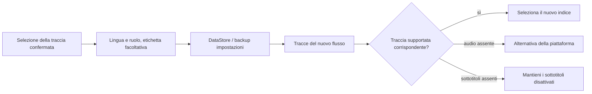

<div lang="it" dir="ltr">

# Preferenze persistenti per audio e sottotitoli

<!-- language-navigation:start -->
<p dir="ltr">
<a href="TRACK-PREFERENCES.md" lang="en" dir="ltr">English</a> · <a href="TRACK-PREFERENCES.ar.md" lang="ar" dir="rtl">العربية</a> · <a href="TRACK-PREFERENCES.bn.md" lang="bn" dir="ltr">বাংলা</a> · <a href="TRACK-PREFERENCES.cs.md" lang="cs" dir="ltr">Čeština</a> · <a href="TRACK-PREFERENCES.de.md" lang="de" dir="ltr">Deutsch</a> · <a href="TRACK-PREFERENCES.es.md" lang="es" dir="ltr">Español</a> · <a href="TRACK-PREFERENCES.fa.md" lang="fa" dir="rtl">فارسی</a> · <a href="TRACK-PREFERENCES.fr.md" lang="fr" dir="ltr">Français</a><br>
<a href="TRACK-PREFERENCES.he.md" lang="he" dir="rtl">עברית</a> · <a href="TRACK-PREFERENCES.hi.md" lang="hi" dir="ltr">हिन्दी</a> · <a href="TRACK-PREFERENCES.id.md" lang="id" dir="ltr">Bahasa Indonesia</a> · <a href="TRACK-PREFERENCES.it.md" lang="it" dir="ltr">Italiano</a> · <a href="TRACK-PREFERENCES.ja.md" lang="ja" dir="ltr">日本語</a> · <a href="TRACK-PREFERENCES.ko.md" lang="ko" dir="ltr">한국어</a> · <a href="TRACK-PREFERENCES.nl.md" lang="nl" dir="ltr">Nederlands</a> · <a href="TRACK-PREFERENCES.pl.md" lang="pl" dir="ltr">Polski</a><br>
<a href="TRACK-PREFERENCES.pt.md" lang="pt" dir="ltr">Português</a> · <a href="TRACK-PREFERENCES.ru.md" lang="ru" dir="ltr">Русский</a> · <a href="TRACK-PREFERENCES.th.md" lang="th" dir="ltr">ไทย</a> · <a href="TRACK-PREFERENCES.tr.md" lang="tr" dir="ltr">Türkçe</a> · <a href="TRACK-PREFERENCES.uk.md" lang="uk" dir="ltr">Українська</a> · <a href="TRACK-PREFERENCES.vi.md" lang="vi" dir="ltr">Tiếng Việt</a> · <a href="TRACK-PREFERENCES.zh-Hans.md" lang="zh-Hans" dir="ltr">简体中文</a> · <a href="TRACK-PREFERENCES.zh-Hant.md" lang="zh-Hant" dir="ltr">繁體中文</a>
</p>
<!-- language-navigation:end -->

[README](../README.md)

Nel lettore Android nativo, aprire **Altro → Audio / Sottotitoli**. Una selezione confermata viene salvata tramite lingua e ruolo, non tramite l’indice nel manifest. Un nuovo canale può riordinare le tracce senza cambiare la lingua richiesta. L’etichetta viene usata solo quando la traccia non indica una lingua. Le tracce prive di lingua, etichetta e ruolo restano una scelta limitata al flusso corrente.

- **Auto** elimina la preferenza esplicita e ripristina la selezione della piattaforma Media3, inclusa la lingua del dispositivo. Confermare Auto cancella anche una preferenza la cui lingua è assente nel flusso corrente.
- **Disattivati** mantiene i sottotitoli disabilitati durante i cambi di canale e i riavvii.
- Se l’audio richiesto manca, Media3 sceglie un’alternativa riproducibile. La preferenza salvata rimane disponibile per il prossimo flusso corrispondente.
- Se i sottotitoli richiesti mancano, restano disabilitati. Ricompaiono quando un flusso successivo contiene lingua e ruolo richiesti.
- Le scelte esplicite sono incluse nei backup delle impostazioni. I backup creati prima di questa funzione usano Auto per entrambi i tipi di traccia. La validazione dell’importazione rifiuta preferenze malformate prima di scrivere nell’archivio delle sorgenti o nel catalogo.



I cataloghi di risorse Android esistenti e la finestra di selezione delle tracce localizzata di Media3 forniscono le etichette; questa funzione non aggiunge messaggi di interfaccia solo in inglese. La finestra applica la scelta confermata al controller ed emette un’azione dell’app; il ViewModel la scrive nel proprio ambito, quindi chiudere il pannello non annulla il salvataggio. Il servizio applica le preferenze salvate. Gli eventi automatici del decoder non sovrascrivono mai una preferenza salvata.

La selezione temporanea di una traccia senza etichetta ha la precedenza per l’elemento multimediale corrente, anche se in seguito arriva una precedente scrittura delle preferenze o una modifica indipendente dei sottotitoli. La scelta esplicita di Auto o di un’altra traccia rimuove tale selezione temporanea. Il passaggio a un altro elemento multimediale la fa sempre scadere, anche quando il flusso successivo annuncia un gruppo di tracce equivalente. Rilasciare il lettore annulla anche l’osservazione delle preferenze.

## Verifica

```sh
./gradlew :app:testDebugUnitTest --tests '*TrackPreferencesTest' --tests '*TrackPreferencePlayerTest' --tests '*SettingsBackupPolicyTest' :app:assembleDebug
```

I test coprono tracce riordinate, ruoli di commento, sottotitoli che scompaiono e ritornano, Disattivati/Auto, conferme tardive delle preferenze, passaggi tra elementi con gruppi equivalenti, rilascio del lettore, esportazione e reimportazione delle impostazioni e importazioni malformate. Su un dispositivo, selezionare una lingua audio e i sottotitoli, passare a un flusso con ordine delle tracce invertito, riavviare l’app, poi provare un flusso senza quelle tracce e scegliere Auto. Questa verifica della riproduzione sul dispositivo resta necessaria; i test unitari non dimostrano che i metadati del fornitore del flusso siano corretti.

</div>
