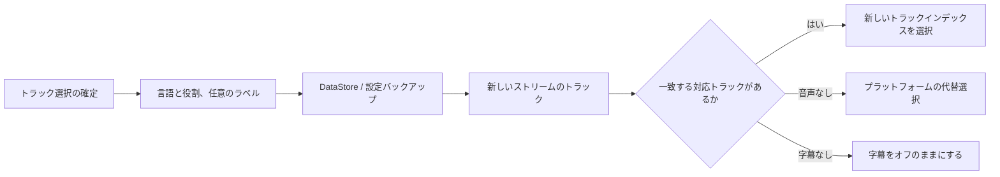

<div lang="ja" dir="ltr">

# 音声と字幕の設定を保持する

<!-- language-navigation:start -->
<p dir="ltr">
<a href="TRACK-PREFERENCES.md" lang="en" dir="ltr">English</a> · <a href="TRACK-PREFERENCES.ar.md" lang="ar" dir="rtl">العربية</a> · <a href="TRACK-PREFERENCES.bn.md" lang="bn" dir="ltr">বাংলা</a> · <a href="TRACK-PREFERENCES.cs.md" lang="cs" dir="ltr">Čeština</a> · <a href="TRACK-PREFERENCES.de.md" lang="de" dir="ltr">Deutsch</a> · <a href="TRACK-PREFERENCES.es.md" lang="es" dir="ltr">Español</a> · <a href="TRACK-PREFERENCES.fa.md" lang="fa" dir="rtl">فارسی</a> · <a href="TRACK-PREFERENCES.fr.md" lang="fr" dir="ltr">Français</a><br>
<a href="TRACK-PREFERENCES.he.md" lang="he" dir="rtl">עברית</a> · <a href="TRACK-PREFERENCES.hi.md" lang="hi" dir="ltr">हिन्दी</a> · <a href="TRACK-PREFERENCES.id.md" lang="id" dir="ltr">Bahasa Indonesia</a> · <a href="TRACK-PREFERENCES.it.md" lang="it" dir="ltr">Italiano</a> · <a href="TRACK-PREFERENCES.ja.md" lang="ja" dir="ltr">日本語</a> · <a href="TRACK-PREFERENCES.ko.md" lang="ko" dir="ltr">한국어</a> · <a href="TRACK-PREFERENCES.nl.md" lang="nl" dir="ltr">Nederlands</a> · <a href="TRACK-PREFERENCES.pl.md" lang="pl" dir="ltr">Polski</a><br>
<a href="TRACK-PREFERENCES.pt.md" lang="pt" dir="ltr">Português</a> · <a href="TRACK-PREFERENCES.ru.md" lang="ru" dir="ltr">Русский</a> · <a href="TRACK-PREFERENCES.th.md" lang="th" dir="ltr">ไทย</a> · <a href="TRACK-PREFERENCES.tr.md" lang="tr" dir="ltr">Türkçe</a> · <a href="TRACK-PREFERENCES.uk.md" lang="uk" dir="ltr">Українська</a> · <a href="TRACK-PREFERENCES.vi.md" lang="vi" dir="ltr">Tiếng Việt</a> · <a href="TRACK-PREFERENCES.zh-Hans.md" lang="zh-Hans" dir="ltr">简体中文</a> · <a href="TRACK-PREFERENCES.zh-Hant.md" lang="zh-Hant" dir="ltr">繁體中文</a>
</p>
<!-- language-navigation:end -->

[README](../README.md)

Android のネイティブプレーヤーで **その他 → 音声 / 字幕** を開きます。確定した選択は、マニフェスト内のインデックスではなく、言語と役割で保存されます。新しいチャンネルでトラックの順序が変わっても、指定した言語は変わりません。ラベルはトラックに言語情報がない場合にのみ使われます。言語、ラベル、役割のいずれもないトラックの選択は、現在のストリームだけに適用されます。

- **自動** は明示的な設定を削除し、端末の言語を含む Media3 のプラットフォーム選択に戻します。「自動」を確定すると、現在のストリームに存在しない言語の設定も消去されます。
- **オフ** は、チャンネルの切り替えや再起動後も字幕を無効に保ちます。
- 指定した音声がない場合、Media3 は再生可能な代替トラックを選びます。保存した設定は、次に一致するストリームのために保持されます。
- 指定した字幕がない場合、字幕は無効のままです。後のストリームに指定した言語と役割が含まれると、字幕が戻ります。
- 明示的な選択は設定のバックアップに含まれます。この機能の追加前に作成されたバックアップでは、両方のトラック種別に「自動」が使われます。インポート時の検証は、ソース保管領域やカタログに書き込む前に、不正な形式の設定を拒否します。



ラベルには既存の Android リソースカタログと Media3 のローカライズ済みトラックダイアログを使用します。この機能は英語だけの UI メッセージを追加しません。ダイアログは確定した選択をコントローラーに適用し、アプリのアクションを送信します。ViewModel は自身のスコープ内で設定を書き込むため、ペインを閉じても保存はキャンセルされません。サービスが保存済みの設定を適用します。デコーダーの自動イベントが保存済み設定を上書きすることはありません。

ラベルのないトラックを一時的に指定した場合、後から古い設定の書き込みや無関係な字幕変更が届いても、現在のメディア項目ではその指定が優先されます。「自動」または別のトラックを明示的に選ぶと、一時指定が解除されます。メディア項目の切り替えでは、次のストリームが同等のトラックグループを通知する場合も含め、必ず一時指定が失効します。プレーヤーを解放すると、設定の監視もキャンセルされます。

## 検証

```sh
./gradlew :app:testDebugUnitTest --tests '*TrackPreferencesTest' --tests '*TrackPreferencePlayerTest' --tests '*SettingsBackupPolicyTest' :app:assembleDebug
```

テストでは、トラックの並べ替え、解説の役割、字幕の消失と復帰、オフと自動、遅れて届く設定確認、同等のグループを持つメディア項目への切り替え、プレーヤーの解放、設定のエクスポートと再インポート、不正なインポートを確認します。端末では音声言語と字幕を選び、トラック順序が逆のストリームに移動し、アプリを再起動してください。その後、それらのトラックがないストリームを試して「自動」を選びます。この実機再生確認は引き続き必要です。ユニットテストだけでは、ストリーム提供元のメタデータが正しいことは証明できません。

</div>
