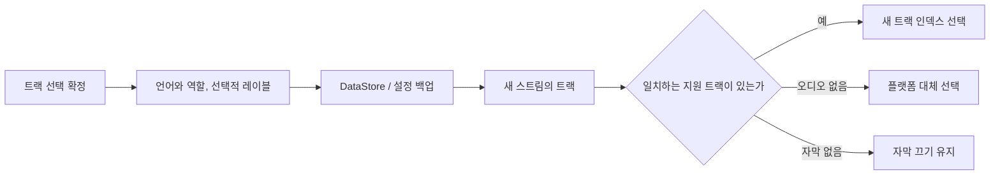

<div lang="ko" dir="ltr">

# 오디오 및 자막 환경설정 유지

<!-- language-navigation:start -->
<p dir="ltr">
<a href="TRACK-PREFERENCES.md" lang="en" dir="ltr">English</a> · <a href="TRACK-PREFERENCES.ar.md" lang="ar" dir="rtl">العربية</a> · <a href="TRACK-PREFERENCES.bn.md" lang="bn" dir="ltr">বাংলা</a> · <a href="TRACK-PREFERENCES.cs.md" lang="cs" dir="ltr">Čeština</a> · <a href="TRACK-PREFERENCES.de.md" lang="de" dir="ltr">Deutsch</a> · <a href="TRACK-PREFERENCES.es.md" lang="es" dir="ltr">Español</a> · <a href="TRACK-PREFERENCES.fa.md" lang="fa" dir="rtl">فارسی</a> · <a href="TRACK-PREFERENCES.fr.md" lang="fr" dir="ltr">Français</a><br>
<a href="TRACK-PREFERENCES.he.md" lang="he" dir="rtl">עברית</a> · <a href="TRACK-PREFERENCES.hi.md" lang="hi" dir="ltr">हिन्दी</a> · <a href="TRACK-PREFERENCES.id.md" lang="id" dir="ltr">Bahasa Indonesia</a> · <a href="TRACK-PREFERENCES.it.md" lang="it" dir="ltr">Italiano</a> · <a href="TRACK-PREFERENCES.ja.md" lang="ja" dir="ltr">日本語</a> · <a href="TRACK-PREFERENCES.ko.md" lang="ko" dir="ltr">한국어</a> · <a href="TRACK-PREFERENCES.nl.md" lang="nl" dir="ltr">Nederlands</a> · <a href="TRACK-PREFERENCES.pl.md" lang="pl" dir="ltr">Polski</a><br>
<a href="TRACK-PREFERENCES.pt.md" lang="pt" dir="ltr">Português</a> · <a href="TRACK-PREFERENCES.ru.md" lang="ru" dir="ltr">Русский</a> · <a href="TRACK-PREFERENCES.th.md" lang="th" dir="ltr">ไทย</a> · <a href="TRACK-PREFERENCES.tr.md" lang="tr" dir="ltr">Türkçe</a> · <a href="TRACK-PREFERENCES.uk.md" lang="uk" dir="ltr">Українська</a> · <a href="TRACK-PREFERENCES.vi.md" lang="vi" dir="ltr">Tiếng Việt</a> · <a href="TRACK-PREFERENCES.zh-Hans.md" lang="zh-Hans" dir="ltr">简体中文</a> · <a href="TRACK-PREFERENCES.zh-Hant.md" lang="zh-Hant" dir="ltr">繁體中文</a>
</p>
<!-- language-navigation:end -->

[README](../README.md)

Android 네이티브 플레이어에서 **더보기 → 오디오 / 자막**을 엽니다. 확정한 선택은 매니페스트의 인덱스가 아니라 언어와 역할로 저장됩니다. 새 채널에서 트랙 순서가 바뀌어도 요청한 언어는 바뀌지 않습니다. 트랙에 언어 정보가 없을 때만 레이블을 사용합니다. 언어, 레이블, 역할이 모두 없는 트랙은 현재 스트림에만 적용되는 선택입니다.

- **자동**은 명시적 환경설정을 제거하고 기기 언어를 포함한 Media3 플랫폼 선택으로 되돌립니다. 자동을 확정하면 현재 스트림에 없는 언어의 환경설정도 지워집니다.
- **끄기**는 채널을 바꾸거나 다시 시작해도 자막을 비활성 상태로 유지합니다.
- 요청한 오디오가 없으면 Media3가 재생 가능한 대체 트랙을 선택합니다. 저장된 환경설정은 다음에 일치하는 스트림을 위해 유지됩니다.
- 요청한 자막이 없으면 자막은 비활성 상태로 유지됩니다. 이후 스트림에 요청한 언어와 역할이 있으면 다시 표시됩니다.
- 명시적 선택은 설정 백업에 포함됩니다. 이 기능 이전에 만든 백업은 두 트랙 유형 모두 자동을 사용합니다. 가져오기 검증은 소스 저장소나 카탈로그에 쓰기 전에 형식이 잘못된 환경설정을 거부합니다.



기존 Android 리소스 카탈로그와 현지화된 Media3 트랙 대화상자가 레이블을 제공합니다. 이 기능은 영어로만 된 UI 메시지를 추가하지 않습니다. 대화상자는 확정한 선택을 컨트롤러에 적용하고 앱 동작을 전달합니다. ViewModel이 자체 범위에서 기록하므로 창을 닫아도 저장이 취소되지 않습니다. 서비스가 저장된 환경설정을 적용합니다. 자동 디코더 이벤트는 저장된 환경설정을 덮어쓰지 않습니다.

레이블이 없는 트랙의 임시 선택은 나중에 오래된 환경설정 쓰기나 관련 없는 자막 변경이 도착해도 현재 미디어 항목에서 우선합니다. 자동 또는 다른 트랙을 명시적으로 선택하면 이 임시 선택이 제거됩니다. 다음 스트림이 동등한 트랙 그룹을 알리는 경우에도 미디어 항목 전환 시 항상 만료됩니다. 플레이어를 해제하면 환경설정 관찰도 취소됩니다.

## 검증

```sh
./gradlew :app:testDebugUnitTest --tests '*TrackPreferencesTest' --tests '*TrackPreferencePlayerTest' --tests '*SettingsBackupPolicyTest' :app:assembleDebug
```

테스트는 트랙 순서 변경, 해설 역할, 사라졌다가 돌아오는 자막, 끄기/자동, 늦게 도착한 환경설정 확인, 동등한 그룹의 미디어 항목 전환, 플레이어 해제, 설정 내보내기 및 다시 가져오기, 잘못된 가져오기를 다룹니다. 실제 기기에서 오디오 언어와 자막을 선택하고, 트랙 순서가 반대인 스트림으로 이동한 뒤 앱을 다시 시작합니다. 그다음 해당 트랙이 없는 스트림을 시도하고 자동을 선택합니다. 이러한 실제 기기 재생 검사는 여전히 필요합니다. 단위 테스트만으로는 스트림 제공업체의 메타데이터가 올바르다고 증명할 수 없습니다.

</div>
