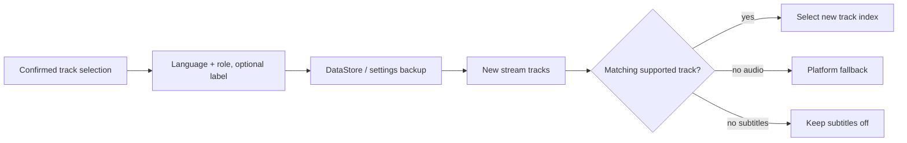

# Persistent audio and subtitle preferences

<!-- language-navigation:start -->

<a href="TRACK-PREFERENCES.md" lang="en" dir="ltr">English</a> · <a href="TRACK-PREFERENCES.ar.md" lang="ar" dir="rtl">العربية</a> · <a href="TRACK-PREFERENCES.bn.md" lang="bn" dir="ltr">বাংলা</a> · <a href="TRACK-PREFERENCES.cs.md" lang="cs" dir="ltr">Čeština</a> · <a href="TRACK-PREFERENCES.de.md" lang="de" dir="ltr">Deutsch</a> · <a href="TRACK-PREFERENCES.es.md" lang="es" dir="ltr">Español</a> · <a href="TRACK-PREFERENCES.fa.md" lang="fa" dir="rtl">فارسی</a> · <a href="TRACK-PREFERENCES.fr.md" lang="fr" dir="ltr">Français</a> 
<a href="TRACK-PREFERENCES.he.md" lang="he" dir="rtl">עברית</a> · <a href="TRACK-PREFERENCES.hi.md" lang="hi" dir="ltr">हिन्दी</a> · <a href="TRACK-PREFERENCES.id.md" lang="id" dir="ltr">Bahasa Indonesia</a> · <a href="TRACK-PREFERENCES.it.md" lang="it" dir="ltr">Italiano</a> · <a href="TRACK-PREFERENCES.ja.md" lang="ja" dir="ltr">日本語</a> · <a href="TRACK-PREFERENCES.ko.md" lang="ko" dir="ltr">한국어</a> · <a href="TRACK-PREFERENCES.nl.md" lang="nl" dir="ltr">Nederlands</a> · <a href="TRACK-PREFERENCES.pl.md" lang="pl" dir="ltr">Polski</a> 
<a href="TRACK-PREFERENCES.pt.md" lang="pt" dir="ltr">Português</a> · <a href="TRACK-PREFERENCES.ru.md" lang="ru" dir="ltr">Русский</a> · <a href="TRACK-PREFERENCES.th.md" lang="th" dir="ltr">ไทย</a> · <a href="TRACK-PREFERENCES.tr.md" lang="tr" dir="ltr">Türkçe</a> · <a href="TRACK-PREFERENCES.uk.md" lang="uk" dir="ltr">Українська</a> · <a href="TRACK-PREFERENCES.vi.md" lang="vi" dir="ltr">Tiếng Việt</a> · <a href="TRACK-PREFERENCES.zh-Hans.md" lang="zh-Hans" dir="ltr">简体中文</a> · <a href="TRACK-PREFERENCES.zh-Hant.md" lang="zh-Hant" dir="ltr">繁體中文</a>

<!-- language-navigation:end -->

[README](../README.md)

In the native Android player, open **More → Audio / Subtitles**. A confirmed selection is saved as its language and role, not its manifest index. A new channel can reorder the tracks without changing the requested language. A label is used only when the track has no language. Tracks without any language, label or role remain a choice for the current stream only.

- **Auto** removes the explicit preference and restores Media3 platform selection, including the device language. Confirming Auto also clears a preference whose language is absent from the current stream.
- **Off** keeps subtitles disabled across channels and restarts.
- If the requested audio is absent, Media3 chooses a playable fallback. The saved preference remains available for the next matching stream.
- If requested subtitles are absent, subtitles stay disabled. They return when a later stream contains the requested language and role.
- Explicit choices are included in settings backups. Backups created before this feature use Auto for both track types. Import validation rejects malformed preferences before writing the source vault or catalog.

The existing Android resource catalogs and Media3's localized track dialog supply the labels; this feature adds no English-only UI messages. The dialog applies the confirmed choice to the controller and emits an app action; the ViewModel writes it in its own scope, so closing the pane does not cancel persistence. The service applies saved preferences. Automatic decoder events never overwrite a saved preference.

An unlabelled track override takes precedence for its current media item, even when an older preference write or an unrelated subtitle change arrives later. Explicit Auto or another track selection removes that override. A media-item transition always expires it, including when the next stream advertises an equal track group. Releasing the player also cancels preference observation.

## Verification

Run `./gradlew :app:testDebugUnitTest --tests '*TrackPreferencesTest' --tests '*TrackPreferencePlayerTest' --tests '*SettingsBackupPolicyTest' :app:assembleDebug`.

Tests cover reordered tracks, commentary roles, missing-and-returning subtitles, Off/Auto, late preference acknowledgements, equal-group media transitions, player release, settings round trips and malformed imports. On a device, select an audio language and subtitles, move to a stream with reversed track order, restart the app, then try a stream without those tracks and choose Auto. This physical playback check remains necessary; unit tests do not prove a stream provider's metadata is correct.
