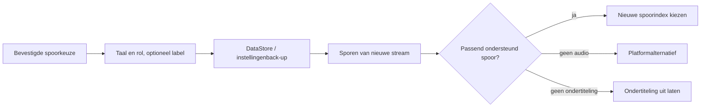

<div lang="nl" dir="ltr">

# Blijvende voorkeuren voor audio en ondertiteling

<!-- language-navigation:start -->
<p dir="ltr">
<a href="TRACK-PREFERENCES.md" lang="en" dir="ltr">English</a> · <a href="TRACK-PREFERENCES.ar.md" lang="ar" dir="rtl">العربية</a> · <a href="TRACK-PREFERENCES.bn.md" lang="bn" dir="ltr">বাংলা</a> · <a href="TRACK-PREFERENCES.cs.md" lang="cs" dir="ltr">Čeština</a> · <a href="TRACK-PREFERENCES.de.md" lang="de" dir="ltr">Deutsch</a> · <a href="TRACK-PREFERENCES.es.md" lang="es" dir="ltr">Español</a> · <a href="TRACK-PREFERENCES.fa.md" lang="fa" dir="rtl">فارسی</a> · <a href="TRACK-PREFERENCES.fr.md" lang="fr" dir="ltr">Français</a><br>
<a href="TRACK-PREFERENCES.he.md" lang="he" dir="rtl">עברית</a> · <a href="TRACK-PREFERENCES.hi.md" lang="hi" dir="ltr">हिन्दी</a> · <a href="TRACK-PREFERENCES.id.md" lang="id" dir="ltr">Bahasa Indonesia</a> · <a href="TRACK-PREFERENCES.it.md" lang="it" dir="ltr">Italiano</a> · <a href="TRACK-PREFERENCES.ja.md" lang="ja" dir="ltr">日本語</a> · <a href="TRACK-PREFERENCES.ko.md" lang="ko" dir="ltr">한국어</a> · <a href="TRACK-PREFERENCES.nl.md" lang="nl" dir="ltr">Nederlands</a> · <a href="TRACK-PREFERENCES.pl.md" lang="pl" dir="ltr">Polski</a><br>
<a href="TRACK-PREFERENCES.pt.md" lang="pt" dir="ltr">Português</a> · <a href="TRACK-PREFERENCES.ru.md" lang="ru" dir="ltr">Русский</a> · <a href="TRACK-PREFERENCES.th.md" lang="th" dir="ltr">ไทย</a> · <a href="TRACK-PREFERENCES.tr.md" lang="tr" dir="ltr">Türkçe</a> · <a href="TRACK-PREFERENCES.uk.md" lang="uk" dir="ltr">Українська</a> · <a href="TRACK-PREFERENCES.vi.md" lang="vi" dir="ltr">Tiếng Việt</a> · <a href="TRACK-PREFERENCES.zh-Hans.md" lang="zh-Hans" dir="ltr">简体中文</a> · <a href="TRACK-PREFERENCES.zh-Hant.md" lang="zh-Hant" dir="ltr">繁體中文</a>
</p>
<!-- language-navigation:end -->

[README](../README.md)

Open in de native Android-speler **Meer → Audio / Ondertiteling**. Een bevestigde keuze wordt opgeslagen op basis van taal en rol, niet op basis van de index in het manifest. Een nieuw kanaal kan de sporen anders ordenen zonder de gewenste taal te wijzigen. Een label wordt alleen gebruikt als het spoor geen taal heeft. Sporen zonder taal, label of rol blijven uitsluitend een keuze voor de huidige stream.

- **Auto** verwijdert de expliciete voorkeur en herstelt de platformselectie van Media3, inclusief de apparaattaal. Auto bevestigen wist ook een voorkeur waarvan de taal in de huidige stream ontbreekt.
- **Uit** houdt ondertiteling uitgeschakeld bij kanaalwisselingen en herstarts.
- Als de gewenste audio ontbreekt, kiest Media3 een afspeelbaar alternatief. De opgeslagen voorkeur blijft beschikbaar voor de volgende passende stream.
- Als de gewenste ondertiteling ontbreekt, blijft deze uitgeschakeld. Ze keert terug wanneer een latere stream de gewenste taal en rol bevat.
- Expliciete keuzes worden meegenomen in back-ups van instellingen. Back-ups van vóór deze functie gebruiken Auto voor beide spoortypen. Importvalidatie weigert onjuist gevormde voorkeuren voordat de bronopslag of catalogus wordt beschreven.



De bestaande Android-broncatalogi en het vertaalde sporendialoogvenster van Media3 leveren de labels; deze functie voegt geen uitsluitend Engelstalige interfacemeldingen toe. Het dialoogvenster past de bevestigde keuze toe op de controller en verstuurt een app-actie; het ViewModel schrijft deze binnen zijn eigen scope, zodat het sluiten van het paneel het opslaan niet annuleert. De service past opgeslagen voorkeuren toe. Automatische decodergebeurtenissen overschrijven nooit een opgeslagen voorkeur.

Een tijdelijke keuze van een spoor zonder label heeft voorrang voor het huidige media-item, zelfs als later een oudere schrijfbewerking voor voorkeuren of een onafhankelijke ondertitelwijziging binnenkomt. Een expliciete keuze voor Auto of een ander spoor verwijdert deze tijdelijke keuze. Een overgang naar een ander media-item beëindigt haar altijd, ook wanneer de volgende stream een gelijkwaardige spoorgroep meldt. Het vrijgeven van de speler beëindigt ook het observeren van voorkeuren.

## Verificatie

```sh
./gradlew :app:testDebugUnitTest --tests '*TrackPreferencesTest' --tests '*TrackPreferencePlayerTest' --tests '*SettingsBackupPolicyTest' :app:assembleDebug
```

De tests omvatten opnieuw geordende sporen, commentaarrollen, verdwijnende en terugkerende ondertiteling, Uit/Auto, late bevestigingen van voorkeuren, mediaovergangen met gelijkwaardige groepen, het vrijgeven van de speler, export en herimport van instellingen en onjuiste imports. Selecteer op een apparaat een audiotaal en ondertiteling, ga naar een stream met omgekeerde spoorvolgorde, herstart de app en probeer vervolgens een stream zonder die sporen en kies Auto. Deze afspeelcontrole op een echt apparaat blijft nodig; unittests bewijzen niet dat de metadata van een streamaanbieder correct zijn.

</div>
