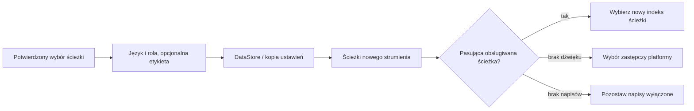

<div lang="pl" dir="ltr">

# Trwałe preferencje dźwięku i napisów

<!-- language-navigation:start -->
<p dir="ltr">
<a href="TRACK-PREFERENCES.md" lang="en" dir="ltr">English</a> · <a href="TRACK-PREFERENCES.ar.md" lang="ar" dir="rtl">العربية</a> · <a href="TRACK-PREFERENCES.bn.md" lang="bn" dir="ltr">বাংলা</a> · <a href="TRACK-PREFERENCES.cs.md" lang="cs" dir="ltr">Čeština</a> · <a href="TRACK-PREFERENCES.de.md" lang="de" dir="ltr">Deutsch</a> · <a href="TRACK-PREFERENCES.es.md" lang="es" dir="ltr">Español</a> · <a href="TRACK-PREFERENCES.fa.md" lang="fa" dir="rtl">فارسی</a> · <a href="TRACK-PREFERENCES.fr.md" lang="fr" dir="ltr">Français</a><br>
<a href="TRACK-PREFERENCES.he.md" lang="he" dir="rtl">עברית</a> · <a href="TRACK-PREFERENCES.hi.md" lang="hi" dir="ltr">हिन्दी</a> · <a href="TRACK-PREFERENCES.id.md" lang="id" dir="ltr">Bahasa Indonesia</a> · <a href="TRACK-PREFERENCES.it.md" lang="it" dir="ltr">Italiano</a> · <a href="TRACK-PREFERENCES.ja.md" lang="ja" dir="ltr">日本語</a> · <a href="TRACK-PREFERENCES.ko.md" lang="ko" dir="ltr">한국어</a> · <a href="TRACK-PREFERENCES.nl.md" lang="nl" dir="ltr">Nederlands</a> · <a href="TRACK-PREFERENCES.pl.md" lang="pl" dir="ltr">Polski</a><br>
<a href="TRACK-PREFERENCES.pt.md" lang="pt" dir="ltr">Português</a> · <a href="TRACK-PREFERENCES.ru.md" lang="ru" dir="ltr">Русский</a> · <a href="TRACK-PREFERENCES.th.md" lang="th" dir="ltr">ไทย</a> · <a href="TRACK-PREFERENCES.tr.md" lang="tr" dir="ltr">Türkçe</a> · <a href="TRACK-PREFERENCES.uk.md" lang="uk" dir="ltr">Українська</a> · <a href="TRACK-PREFERENCES.vi.md" lang="vi" dir="ltr">Tiếng Việt</a> · <a href="TRACK-PREFERENCES.zh-Hans.md" lang="zh-Hans" dir="ltr">简体中文</a> · <a href="TRACK-PREFERENCES.zh-Hant.md" lang="zh-Hant" dir="ltr">繁體中文</a>
</p>
<!-- language-navigation:end -->

[README](../README.md)

W natywnym odtwarzaczu Androida otwórz **Więcej → Dźwięk / Napisy**. Potwierdzony wybór jest zapisywany według języka i roli ścieżki, a nie jej indeksu w manifeście. Nowy kanał może zmienić kolejność ścieżek bez zmiany żądanego języka. Etykieta jest używana tylko wtedy, gdy ścieżka nie ma języka. Ścieżki bez języka, etykiety i roli można wybrać wyłącznie dla bieżącego strumienia.

- **Auto** usuwa jawną preferencję i przywraca wybór platformy Media3, uwzględniający język urządzenia. Potwierdzenie Auto usuwa również preferencję języka nieobecnego w bieżącym strumieniu.
- **Wyłączone** zachowuje wyłączenie napisów po zmianie kanału i ponownym uruchomieniu.
- Jeśli żądany dźwięk jest niedostępny, Media3 wybiera odtwarzalny zamiennik. Zapisana preferencja pozostaje dostępna dla kolejnego pasującego strumienia.
- Jeśli żądane napisy są niedostępne, pozostają wyłączone. Powrócą, gdy późniejszy strumień będzie zawierał żądany język i rolę.
- Jawne wybory są uwzględniane w kopiach zapasowych ustawień. Kopie utworzone przed wprowadzeniem tej funkcji używają Auto dla obu typów ścieżek. Walidacja importu odrzuca nieprawidłowe preferencje przed zapisem w magazynie źródeł lub katalogu.



Etykiety pochodzą z istniejących katalogów zasobów Androida oraz zlokalizowanego okna wyboru ścieżek Media3; funkcja nie dodaje komunikatów interfejsu dostępnych wyłącznie po angielsku. Okno stosuje potwierdzony wybór w kontrolerze i emituje akcję aplikacji. ViewModel zapisuje go we własnym zakresie, więc zamknięcie panelu nie anuluje utrwalania. Usługa stosuje zapisane preferencje. Automatyczne zdarzenia dekodera nigdy nie nadpisują zapisanej preferencji.

Tymczasowy wybór ścieżki bez etykiety ma pierwszeństwo dla bieżącego elementu multimedialnego, nawet jeśli później dotrze starszy zapis preferencji lub niezależna zmiana napisów. Jawny wybór Auto lub innej ścieżki usuwa to ustawienie tymczasowe. Zmiana elementu multimedialnego zawsze je unieważnia, także gdy następny strumień zgłasza równoważną grupę ścieżek. Zwolnienie odtwarzacza anuluje również obserwowanie preferencji.

## Weryfikacja

```sh
./gradlew :app:testDebugUnitTest --tests '*TrackPreferencesTest' --tests '*TrackPreferencePlayerTest' --tests '*SettingsBackupPolicyTest' :app:assembleDebug
```

Testy obejmują zmianę kolejności ścieżek, role komentarza, znikające i powracające napisy, Wyłączone/Auto, opóźnione potwierdzenia preferencji, przejścia między elementami z równoważnymi grupami, zwolnienie odtwarzacza, eksport i ponowny import ustawień oraz nieprawidłowe importy. Na urządzeniu wybierz język dźwięku i napisy, przejdź do strumienia z odwrotną kolejnością ścieżek, uruchom aplikację ponownie, a następnie sprawdź strumień bez tych ścieżek i wybierz Auto. Taka kontrola odtwarzania na fizycznym urządzeniu pozostaje niezbędna; testy jednostkowe nie dowodzą poprawności metadanych dostawcy strumienia.

</div>
