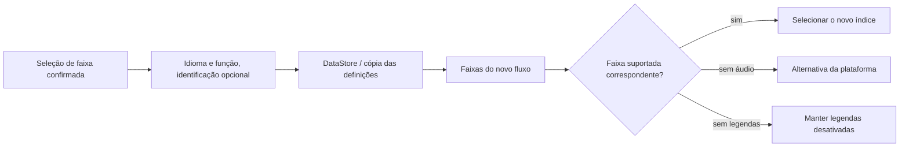

<div lang="pt" dir="ltr">

# Preferências persistentes de áudio e legendas

<!-- language-navigation:start -->
<p dir="ltr">
<a href="TRACK-PREFERENCES.md" lang="en" dir="ltr">English</a> · <a href="TRACK-PREFERENCES.ar.md" lang="ar" dir="rtl">العربية</a> · <a href="TRACK-PREFERENCES.bn.md" lang="bn" dir="ltr">বাংলা</a> · <a href="TRACK-PREFERENCES.cs.md" lang="cs" dir="ltr">Čeština</a> · <a href="TRACK-PREFERENCES.de.md" lang="de" dir="ltr">Deutsch</a> · <a href="TRACK-PREFERENCES.es.md" lang="es" dir="ltr">Español</a> · <a href="TRACK-PREFERENCES.fa.md" lang="fa" dir="rtl">فارسی</a> · <a href="TRACK-PREFERENCES.fr.md" lang="fr" dir="ltr">Français</a><br>
<a href="TRACK-PREFERENCES.he.md" lang="he" dir="rtl">עברית</a> · <a href="TRACK-PREFERENCES.hi.md" lang="hi" dir="ltr">हिन्दी</a> · <a href="TRACK-PREFERENCES.id.md" lang="id" dir="ltr">Bahasa Indonesia</a> · <a href="TRACK-PREFERENCES.it.md" lang="it" dir="ltr">Italiano</a> · <a href="TRACK-PREFERENCES.ja.md" lang="ja" dir="ltr">日本語</a> · <a href="TRACK-PREFERENCES.ko.md" lang="ko" dir="ltr">한국어</a> · <a href="TRACK-PREFERENCES.nl.md" lang="nl" dir="ltr">Nederlands</a> · <a href="TRACK-PREFERENCES.pl.md" lang="pl" dir="ltr">Polski</a><br>
<a href="TRACK-PREFERENCES.pt.md" lang="pt" dir="ltr">Português</a> · <a href="TRACK-PREFERENCES.ru.md" lang="ru" dir="ltr">Русский</a> · <a href="TRACK-PREFERENCES.th.md" lang="th" dir="ltr">ไทย</a> · <a href="TRACK-PREFERENCES.tr.md" lang="tr" dir="ltr">Türkçe</a> · <a href="TRACK-PREFERENCES.uk.md" lang="uk" dir="ltr">Українська</a> · <a href="TRACK-PREFERENCES.vi.md" lang="vi" dir="ltr">Tiếng Việt</a> · <a href="TRACK-PREFERENCES.zh-Hans.md" lang="zh-Hans" dir="ltr">简体中文</a> · <a href="TRACK-PREFERENCES.zh-Hant.md" lang="zh-Hant" dir="ltr">繁體中文</a>
</p>
<!-- language-navigation:end -->

[README](../README.md)

No reprodutor nativo do Android, abra **Mais → Áudio / Legendas**. Uma seleção confirmada é guardada pelo idioma e pela função, não pelo índice no manifesto. Um novo canal pode reordenar as faixas sem alterar o idioma solicitado. A identificação textual só é usada quando a faixa não indica um idioma. Faixas sem idioma, identificação ou função só podem ser escolhidas para o fluxo atual.

- **Auto** remove a preferência explícita e restaura a seleção da plataforma Media3, incluindo o idioma do dispositivo. Confirmar Auto também apaga uma preferência cujo idioma está ausente do fluxo atual.
- **Desativadas** mantém as legendas desativadas ao mudar de canal e reiniciar.
- Se o áudio solicitado estiver ausente, o Media3 escolhe uma alternativa reproduzível. A preferência guardada continua disponível para o próximo fluxo correspondente.
- Se as legendas solicitadas estiverem ausentes, continuam desativadas. Voltam quando um fluxo posterior contém o idioma e a função solicitados.
- As escolhas explícitas são incluídas nas cópias de segurança das definições. Cópias criadas antes desta funcionalidade usam Auto para os dois tipos de faixa. A validação da importação rejeita preferências malformadas antes de escrever no armazenamento de fontes ou no catálogo.



Os catálogos de recursos existentes do Android e a caixa de diálogo de faixas localizada do Media3 fornecem os textos; esta funcionalidade não acrescenta mensagens de interface apenas em inglês. O diálogo aplica a escolha confirmada ao controlador e emite uma ação da aplicação; o ViewModel escreve-a no seu próprio âmbito, pelo que fechar o painel não cancela a persistência. O serviço aplica as preferências guardadas. Os eventos automáticos do descodificador nunca substituem uma preferência guardada.

A seleção temporária de uma faixa sem identificação tem prioridade para o item multimédia atual, mesmo que uma escrita anterior de preferências ou uma alteração independente de legendas chegue depois. Escolher explicitamente Auto ou outra faixa remove essa seleção temporária. Uma transição de item multimédia fá-la sempre expirar, mesmo quando o próximo fluxo anuncia um grupo de faixas equivalente. Libertar o reprodutor também cancela a observação das preferências.

## Verificação

```sh
./gradlew :app:testDebugUnitTest --tests '*TrackPreferencesTest' --tests '*TrackPreferencePlayerTest' --tests '*SettingsBackupPolicyTest' :app:assembleDebug
```

Os testes abrangem faixas reordenadas, funções de comentário, legendas que desaparecem e regressam, Desativadas/Auto, confirmações tardias de preferências, transições multimédia com grupos equivalentes, libertação do reprodutor, exportação e reimportação de definições e importações malformadas. Num dispositivo, selecione um idioma de áudio e legendas, passe para um fluxo com a ordem das faixas invertida, reinicie a aplicação e depois experimente um fluxo sem essas faixas e escolha Auto. Esta verificação de reprodução num dispositivo continua a ser necessária; os testes unitários não provam que os metadados do fornecedor do fluxo estão corretos.

</div>
