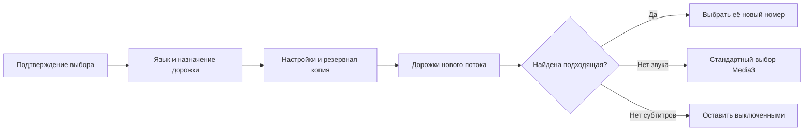

# Запоминание языка звука и субтитров

[English](TRACK-PREFERENCES.md) · [README](../README.md)

В нативном плеере Android откройте **Ещё → Аудио / Субтитры**. Подтверждённый выбор сохраняется по языку и назначению дорожки, а не по её номеру в потоке. Поэтому перестановка дорожек на другом канале не меняет выбранный язык. Если язык не указан, используется название дорожки. Дорожка без языка, названия и назначения выбирается только для текущего потока.

- **Авто** отменяет явный выбор и возвращает стандартный алгоритм Media3, учитывающий язык устройства. Подтверждение «Авто» отменяет и сохранённый язык, которого нет в текущем потоке.
- **Выкл.** сохраняет отключение субтитров после смены канала и перезапуска.
- Если нужного звука нет, Media3 выбирает доступную дорожку. Сохранённое предпочтение применяется снова, когда подходящий звук появляется.
- Если нужных субтитров нет, они остаются выключенными. На следующем подходящем потоке они включатся автоматически.
- Явный выбор входит в резервную копию настроек. В старых копиях обе настройки считаются автоматическими. Некорректные значения отклоняются до записи хранилища источников и каталога.

Подписи берутся из существующих переводов Android и диалога Media3: новых сообщений только на английском не добавлено. Сервис применяет настройки, а диалог записывает только подтверждённый выбор пользователя. Автоматическая смена дорожек декодером не перезаписывает предпочтения.

## Проверка

Команда: `./gradlew :app:testDebugUnitTest --tests '*TrackPreferencesTest' --tests '*SettingsBackupPolicyTest' :app:assembleDebug`.

Тесты проверяют перестановку дорожек, комментарии, исчезновение и возвращение субтитров, отключение и автоматический выбор, перенос через резервную копию и отказ при некорректном импорте. На устройстве дополнительно проверьте смену канала, перезапуск и выбор «Авто» на потоке без предпочитаемого языка. Модульные тесты не подтверждают правильность метаданных у провайдера.
