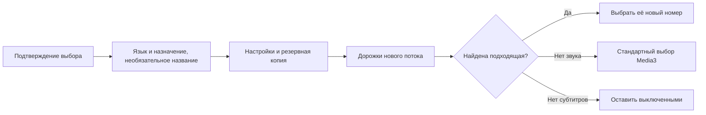

# Запоминание языка звука и субтитров

<!-- language-navigation:start -->

<a href="TRACK-PREFERENCES.md" lang="en" dir="ltr">English</a> · <a href="TRACK-PREFERENCES.ar.md" lang="ar" dir="rtl">العربية</a> · <a href="TRACK-PREFERENCES.bn.md" lang="bn" dir="ltr">বাংলা</a> · <a href="TRACK-PREFERENCES.cs.md" lang="cs" dir="ltr">Čeština</a> · <a href="TRACK-PREFERENCES.de.md" lang="de" dir="ltr">Deutsch</a> · <a href="TRACK-PREFERENCES.es.md" lang="es" dir="ltr">Español</a> · <a href="TRACK-PREFERENCES.fa.md" lang="fa" dir="rtl">فارسی</a> · <a href="TRACK-PREFERENCES.fr.md" lang="fr" dir="ltr">Français</a> 
<a href="TRACK-PREFERENCES.he.md" lang="he" dir="rtl">עברית</a> · <a href="TRACK-PREFERENCES.hi.md" lang="hi" dir="ltr">हिन्दी</a> · <a href="TRACK-PREFERENCES.id.md" lang="id" dir="ltr">Bahasa Indonesia</a> · <a href="TRACK-PREFERENCES.it.md" lang="it" dir="ltr">Italiano</a> · <a href="TRACK-PREFERENCES.ja.md" lang="ja" dir="ltr">日本語</a> · <a href="TRACK-PREFERENCES.ko.md" lang="ko" dir="ltr">한국어</a> · <a href="TRACK-PREFERENCES.nl.md" lang="nl" dir="ltr">Nederlands</a> · <a href="TRACK-PREFERENCES.pl.md" lang="pl" dir="ltr">Polski</a> 
<a href="TRACK-PREFERENCES.pt.md" lang="pt" dir="ltr">Português</a> · <a href="TRACK-PREFERENCES.ru.md" lang="ru" dir="ltr">Русский</a> · <a href="TRACK-PREFERENCES.th.md" lang="th" dir="ltr">ไทย</a> · <a href="TRACK-PREFERENCES.tr.md" lang="tr" dir="ltr">Türkçe</a> · <a href="TRACK-PREFERENCES.uk.md" lang="uk" dir="ltr">Українська</a> · <a href="TRACK-PREFERENCES.vi.md" lang="vi" dir="ltr">Tiếng Việt</a> · <a href="TRACK-PREFERENCES.zh-Hans.md" lang="zh-Hans" dir="ltr">简体中文</a> · <a href="TRACK-PREFERENCES.zh-Hant.md" lang="zh-Hant" dir="ltr">繁體中文</a>

<!-- language-navigation:end -->

[README](../README.md)

В нативном плеере Android откройте **Ещё → Аудио / Субтитры**. Подтверждённый выбор сохраняется по языку и назначению дорожки, а не по её номеру в потоке. Поэтому перестановка дорожек на другом канале не меняет выбранный язык. Если язык не указан, используется название дорожки. Дорожка без языка, названия и назначения выбирается только для текущего потока.

- **Авто** отменяет явный выбор и возвращает стандартный алгоритм Media3, учитывающий язык устройства. Подтверждение «Авто» отменяет и сохранённый язык, которого нет в текущем потоке.
- **Выкл.** сохраняет отключение субтитров после смены канала и перезапуска.
- Если нужного звука нет, Media3 выбирает доступную дорожку. Сохранённое предпочтение применяется снова, когда подходящий звук появляется.
- Если нужных субтитров нет, они остаются выключенными. На следующем подходящем потоке они включатся автоматически.
- Явный выбор входит в резервную копию настроек. В старых копиях обе настройки считаются автоматическими. Некорректные значения отклоняются до записи хранилища источников и каталога.

Подписи берутся из существующих переводов Android и диалога Media3: новых сообщений только на английском не добавлено. Диалог применяет подтверждённый выбор к контроллеру и отправляет действие приложения; ViewModel записывает настройку в собственной области жизни, поэтому закрытие панели не отменяет запись. Сервис применяет сохранённые настройки. Автоматическая смена дорожек декодером не перезаписывает предпочтения.

Дорожка без метаданных имеет приоритет в текущем media item, даже если позже приходит подтверждение старой записи настроек или изменение субтитров. Явный выбор «Авто» или другой дорожки удаляет эту временную привязку. Смена media item всегда завершает её действие, в том числе если новый поток публикует равную группу дорожек. Освобождение плеера отменяет и наблюдение за настройками.

## Проверка

Команда: `./gradlew :app:testDebugUnitTest --tests '*TrackPreferencesTest' --tests '*TrackPreferencePlayerTest' --tests '*SettingsBackupPolicyTest' :app:assembleDebug`.

Тесты проверяют перестановку дорожек, комментарии, исчезновение и возвращение субтитров, отключение и автоматический выбор, запоздавшие подтверждения записи, смену media item с равными группами дорожек, освобождение плеера, перенос через резервную копию и отказ при некорректном импорте. На устройстве выберите язык звука и субтитры, перейдите к потоку с обратным порядком дорожек, перезапустите приложение, затем попробуйте поток без этих дорожек и выберите «Авто». Эта проверка воспроизведения на физическом устройстве остаётся необходимой: модульные тесты не подтверждают правильность метаданных у провайдера.
