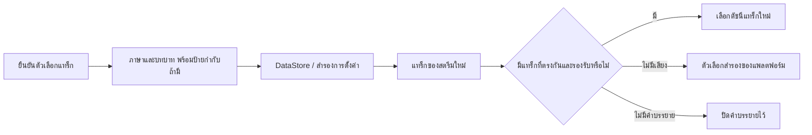

<div lang="th" dir="ltr">

# การบันทึกค่าที่ต้องการสำหรับเสียงและคำบรรยาย

<!-- language-navigation:start -->
<p dir="ltr">
<a href="TRACK-PREFERENCES.md" lang="en" dir="ltr">English</a> · <a href="TRACK-PREFERENCES.ar.md" lang="ar" dir="rtl">العربية</a> · <a href="TRACK-PREFERENCES.bn.md" lang="bn" dir="ltr">বাংলা</a> · <a href="TRACK-PREFERENCES.cs.md" lang="cs" dir="ltr">Čeština</a> · <a href="TRACK-PREFERENCES.de.md" lang="de" dir="ltr">Deutsch</a> · <a href="TRACK-PREFERENCES.es.md" lang="es" dir="ltr">Español</a> · <a href="TRACK-PREFERENCES.fa.md" lang="fa" dir="rtl">فارسی</a> · <a href="TRACK-PREFERENCES.fr.md" lang="fr" dir="ltr">Français</a><br>
<a href="TRACK-PREFERENCES.he.md" lang="he" dir="rtl">עברית</a> · <a href="TRACK-PREFERENCES.hi.md" lang="hi" dir="ltr">हिन्दी</a> · <a href="TRACK-PREFERENCES.id.md" lang="id" dir="ltr">Bahasa Indonesia</a> · <a href="TRACK-PREFERENCES.it.md" lang="it" dir="ltr">Italiano</a> · <a href="TRACK-PREFERENCES.ja.md" lang="ja" dir="ltr">日本語</a> · <a href="TRACK-PREFERENCES.ko.md" lang="ko" dir="ltr">한국어</a> · <a href="TRACK-PREFERENCES.nl.md" lang="nl" dir="ltr">Nederlands</a> · <a href="TRACK-PREFERENCES.pl.md" lang="pl" dir="ltr">Polski</a><br>
<a href="TRACK-PREFERENCES.pt.md" lang="pt" dir="ltr">Português</a> · <a href="TRACK-PREFERENCES.ru.md" lang="ru" dir="ltr">Русский</a> · <a href="TRACK-PREFERENCES.th.md" lang="th" dir="ltr">ไทย</a> · <a href="TRACK-PREFERENCES.tr.md" lang="tr" dir="ltr">Türkçe</a> · <a href="TRACK-PREFERENCES.uk.md" lang="uk" dir="ltr">Українська</a> · <a href="TRACK-PREFERENCES.vi.md" lang="vi" dir="ltr">Tiếng Việt</a> · <a href="TRACK-PREFERENCES.zh-Hans.md" lang="zh-Hans" dir="ltr">简体中文</a> · <a href="TRACK-PREFERENCES.zh-Hant.md" lang="zh-Hant" dir="ltr">繁體中文</a>
</p>
<!-- language-navigation:end -->

[README](../README.md)

ในตัวเล่น Android แบบเนทีฟ ให้เปิด **เพิ่มเติม → เสียง / คำบรรยาย** ตัวเลือกที่ยืนยันแล้วจะบันทึกตามภาษาและบทบาท ไม่ใช่หมายเลขดัชนีในแมนิเฟสต์ ช่องใหม่สามารถเรียงแทร็กใหม่ได้โดยไม่เปลี่ยนภาษาที่ต้องการ ป้ายกำกับจะใช้เฉพาะเมื่อแทร็กไม่มีข้อมูลภาษา แทร็กที่ไม่มีทั้งภาษา ป้ายกำกับ และบทบาท จะเลือกใช้ได้เฉพาะสตรีมปัจจุบันเท่านั้น

- **อัตโนมัติ** ล้างค่าที่ระบุเองและกลับไปใช้การเลือกของแพลตฟอร์ม Media3 รวมถึงภาษาของอุปกรณ์ การยืนยันอัตโนมัติยังล้างค่าภาษาที่ไม่มีในสตรีมปัจจุบันด้วย
- **ปิด** ทำให้คำบรรยายยังคงปิดอยู่เมื่อเปลี่ยนช่องและเริ่มแอปใหม่
- หากไม่มีเสียงที่ต้องการ Media3 จะเลือกแทร็กสำรองที่เล่นได้ ค่าที่บันทึกไว้ยังคงอยู่เพื่อใช้กับสตรีมถัดไปที่ตรงกัน
- หากไม่มีคำบรรยายที่ต้องการ คำบรรยายจะยังปิดอยู่ และจะกลับมาเมื่อสตรีมภายหลังมีภาษาและบทบาทที่ต้องการ
- ตัวเลือกที่ระบุเองจะรวมอยู่ในข้อมูลสำรองการตั้งค่า ข้อมูลสำรองที่สร้างก่อนมีคุณสมบัตินี้จะใช้อัตโนมัติสำหรับแทร็กทั้งสองประเภท การตรวจสอบการนำเข้าจะปฏิเสธค่าที่มีรูปแบบไม่ถูกต้องก่อนเขียนลงคลังแหล่งข้อมูลหรือแค็ตตาล็อก



ป้ายข้อความมาจากแค็ตตาล็อกทรัพยากร Android ที่มีอยู่และกล่องเลือกแทร็กของ Media3 ที่แปลภาษาแล้ว คุณสมบัตินี้ไม่เพิ่มข้อความส่วนติดต่อที่มีเฉพาะภาษาอังกฤษ กล่องโต้ตอบนำตัวเลือกที่ยืนยันไปใช้กับคอนโทรลเลอร์และส่งการกระทำของแอป จากนั้น ViewModel เขียนค่าในขอบเขตของตนเอง ดังนั้นการปิดแผงจะไม่ยกเลิกการบันทึก บริการนำค่าที่บันทึกไว้ไปใช้ เหตุการณ์อัตโนมัติของตัวถอดรหัสจะไม่เขียนทับค่าที่บันทึกไว้

การเลือกแทร็กที่ไม่มีป้ายกำกับแบบชั่วคราวมีลำดับความสำคัญสูงกว่าสำหรับรายการสื่อปัจจุบัน แม้จะมีการเขียนค่าเก่าหรือการเปลี่ยนคำบรรยายที่ไม่เกี่ยวข้องมาถึงภายหลัง การเลือกอัตโนมัติหรือแทร็กอื่นอย่างชัดเจนจะยกเลิกตัวเลือกชั่วคราวนี้ เมื่อเปลี่ยนรายการสื่อ ตัวเลือกนี้จะหมดอายุเสมอ รวมถึงกรณีที่สตรีมถัดไปประกาศกลุ่มแทร็กที่เท่ากัน การปล่อยทรัพยากรตัวเล่นจะยกเลิกการเฝ้าดูค่าที่ต้องการด้วย

## การตรวจสอบ

```sh
./gradlew :app:testDebugUnitTest --tests '*TrackPreferencesTest' --tests '*TrackPreferencePlayerTest' --tests '*SettingsBackupPolicyTest' :app:assembleDebug
```

การทดสอบครอบคลุมการเรียงแทร็กใหม่ บทบาทเสียงบรรยายประกอบ คำบรรยายที่หายไปแล้วกลับมา ปิด/อัตโนมัติ การยืนยันค่าที่มาถึงล่าช้า การเปลี่ยนรายการสื่อที่มีกลุ่มแทร็กเท่ากัน การปล่อยตัวเล่น การส่งออกแล้วนำเข้าการตั้งค่าอีกครั้ง และการนำเข้าที่มีรูปแบบผิด บนอุปกรณ์จริง ให้เลือกภาษาเสียงและคำบรรยาย เปลี่ยนไปยังสตรีมที่มีลำดับแทร็กกลับด้าน เริ่มแอปใหม่ แล้วลองสตรีมที่ไม่มีแทร็กเหล่านั้นและเลือกอัตโนมัติ การตรวจสอบการเล่นบนอุปกรณ์จริงนี้ยังจำเป็น การทดสอบหน่วยไม่ได้พิสูจน์ว่าข้อมูลเมทาดาทาของผู้ให้บริการสตรีมถูกต้อง

</div>
