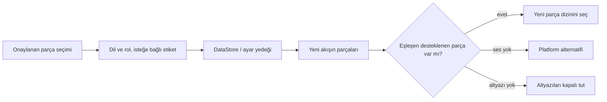

<div lang="tr" dir="ltr">

# Kalıcı ses ve altyazı tercihleri

<!-- language-navigation:start -->
<p dir="ltr">
<a href="TRACK-PREFERENCES.md" lang="en" dir="ltr">English</a> · <a href="TRACK-PREFERENCES.ar.md" lang="ar" dir="rtl">العربية</a> · <a href="TRACK-PREFERENCES.bn.md" lang="bn" dir="ltr">বাংলা</a> · <a href="TRACK-PREFERENCES.cs.md" lang="cs" dir="ltr">Čeština</a> · <a href="TRACK-PREFERENCES.de.md" lang="de" dir="ltr">Deutsch</a> · <a href="TRACK-PREFERENCES.es.md" lang="es" dir="ltr">Español</a> · <a href="TRACK-PREFERENCES.fa.md" lang="fa" dir="rtl">فارسی</a> · <a href="TRACK-PREFERENCES.fr.md" lang="fr" dir="ltr">Français</a><br>
<a href="TRACK-PREFERENCES.he.md" lang="he" dir="rtl">עברית</a> · <a href="TRACK-PREFERENCES.hi.md" lang="hi" dir="ltr">हिन्दी</a> · <a href="TRACK-PREFERENCES.id.md" lang="id" dir="ltr">Bahasa Indonesia</a> · <a href="TRACK-PREFERENCES.it.md" lang="it" dir="ltr">Italiano</a> · <a href="TRACK-PREFERENCES.ja.md" lang="ja" dir="ltr">日本語</a> · <a href="TRACK-PREFERENCES.ko.md" lang="ko" dir="ltr">한국어</a> · <a href="TRACK-PREFERENCES.nl.md" lang="nl" dir="ltr">Nederlands</a> · <a href="TRACK-PREFERENCES.pl.md" lang="pl" dir="ltr">Polski</a><br>
<a href="TRACK-PREFERENCES.pt.md" lang="pt" dir="ltr">Português</a> · <a href="TRACK-PREFERENCES.ru.md" lang="ru" dir="ltr">Русский</a> · <a href="TRACK-PREFERENCES.th.md" lang="th" dir="ltr">ไทย</a> · <a href="TRACK-PREFERENCES.tr.md" lang="tr" dir="ltr">Türkçe</a> · <a href="TRACK-PREFERENCES.uk.md" lang="uk" dir="ltr">Українська</a> · <a href="TRACK-PREFERENCES.vi.md" lang="vi" dir="ltr">Tiếng Việt</a> · <a href="TRACK-PREFERENCES.zh-Hans.md" lang="zh-Hans" dir="ltr">简体中文</a> · <a href="TRACK-PREFERENCES.zh-Hant.md" lang="zh-Hant" dir="ltr">繁體中文</a>
</p>
<!-- language-navigation:end -->

[README](../README.md)

Yerel Android oynatıcıda **Diğer → Ses / Altyazılar** menüsünü açın. Onaylanan seçim, manifestteki dizin numarasıyla değil dili ve rolüyle kaydedilir. Yeni bir kanal, istenen dili değiştirmeden parçaları yeniden sıralayabilir. Etiket yalnızca parçanın dil bilgisi yoksa kullanılır. Dili, etiketi ve rolü olmayan parçalar yalnızca geçerli akış için seçilebilir.

- **Otomatik**, açıkça belirlenmiş tercihi kaldırır ve cihaz dili de dahil olmak üzere Media3 platform seçimini geri getirir. Otomatik seçimini onaylamak, dili geçerli akışta bulunmayan bir tercihi de temizler.
- **Kapalı**, kanal değiştirildiğinde ve uygulama yeniden başlatıldığında altyazıları kapalı tutar.
- İstenen ses yoksa Media3 oynatılabilir bir alternatif seçer. Kaydedilmiş tercih, sonraki eşleşen akış için korunur.
- İstenen altyazılar yoksa kapalı kalırlar. Sonraki bir akış istenen dili ve rolü içerdiğinde geri gelirler.
- Açıkça yapılan seçimler ayar yedeklerine dahil edilir. Bu özellikten önce oluşturulan yedekler, her iki parça türü için Otomatik kullanır. İçe aktarma doğrulaması, kaynak kasasına veya kataloğa yazmadan önce bozuk tercihleri reddeder.



Etiketleri mevcut Android kaynak katalogları ve Media3’ün yerelleştirilmiş parça iletişim kutusu sağlar; bu özellik yalnızca İngilizce olan yeni arayüz mesajları eklemez. İletişim kutusu onaylanan seçimi denetleyiciye uygular ve bir uygulama eylemi üretir; ViewModel bunu kendi kapsamı içinde yazar, dolayısıyla panelin kapanması kalıcı kaydı iptal etmez. Hizmet kaydedilmiş tercihleri uygular. Otomatik kod çözücü olayları kaydedilmiş bir tercihin üzerine asla yazmaz.

Etiketsiz bir parçanın geçici seçimi, daha eski bir tercih yazımı veya bağımsız bir altyazı değişikliği sonradan gelse bile geçerli medya öğesi için önceliklidir. Açıkça Otomatik veya başka bir parça seçildiğinde bu geçici seçim kaldırılır. Sonraki akış eşdeğer bir parça grubu bildirse bile medya öğesi geçişi her zaman bu seçimi sona erdirir. Oynatıcı kaynaklarının serbest bırakılması tercihlerin gözlemlenmesini de iptal eder.

## Doğrulama

```sh
./gradlew :app:testDebugUnitTest --tests '*TrackPreferencesTest' --tests '*TrackPreferencePlayerTest' --tests '*SettingsBackupPolicyTest' :app:assembleDebug
```

Testler yeniden sıralanmış parçaları, yorum rollerini, kaybolup geri gelen altyazıları, Kapalı/Otomatik seçeneklerini, gecikmiş tercih onaylarını, eşdeğer gruplar arasındaki medya geçişlerini, oynatıcının serbest bırakılmasını, ayarların dışa ve tekrar içe aktarılmasını ve bozuk içe aktarmaları kapsar. Bir cihazda ses dili ve altyazı seçin, parça sırası ters olan bir akışa geçin, uygulamayı yeniden başlatın, ardından bu parçaları içermeyen bir akışı deneyip Otomatik seçin. Fiziksel cihazdaki bu oynatma kontrolü hâlâ gereklidir; birim testleri akış sağlayıcısının meta verilerinin doğru olduğunu kanıtlamaz.

</div>
