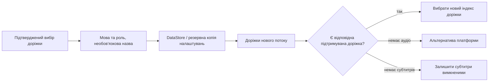

<div lang="uk" dir="ltr">

# Збереження налаштувань аудіо та субтитрів

<!-- language-navigation:start -->
<p dir="ltr">
<a href="TRACK-PREFERENCES.md" lang="en" dir="ltr">English</a> · <a href="TRACK-PREFERENCES.ar.md" lang="ar" dir="rtl">العربية</a> · <a href="TRACK-PREFERENCES.bn.md" lang="bn" dir="ltr">বাংলা</a> · <a href="TRACK-PREFERENCES.cs.md" lang="cs" dir="ltr">Čeština</a> · <a href="TRACK-PREFERENCES.de.md" lang="de" dir="ltr">Deutsch</a> · <a href="TRACK-PREFERENCES.es.md" lang="es" dir="ltr">Español</a> · <a href="TRACK-PREFERENCES.fa.md" lang="fa" dir="rtl">فارسی</a> · <a href="TRACK-PREFERENCES.fr.md" lang="fr" dir="ltr">Français</a><br>
<a href="TRACK-PREFERENCES.he.md" lang="he" dir="rtl">עברית</a> · <a href="TRACK-PREFERENCES.hi.md" lang="hi" dir="ltr">हिन्दी</a> · <a href="TRACK-PREFERENCES.id.md" lang="id" dir="ltr">Bahasa Indonesia</a> · <a href="TRACK-PREFERENCES.it.md" lang="it" dir="ltr">Italiano</a> · <a href="TRACK-PREFERENCES.ja.md" lang="ja" dir="ltr">日本語</a> · <a href="TRACK-PREFERENCES.ko.md" lang="ko" dir="ltr">한국어</a> · <a href="TRACK-PREFERENCES.nl.md" lang="nl" dir="ltr">Nederlands</a> · <a href="TRACK-PREFERENCES.pl.md" lang="pl" dir="ltr">Polski</a><br>
<a href="TRACK-PREFERENCES.pt.md" lang="pt" dir="ltr">Português</a> · <a href="TRACK-PREFERENCES.ru.md" lang="ru" dir="ltr">Русский</a> · <a href="TRACK-PREFERENCES.th.md" lang="th" dir="ltr">ไทย</a> · <a href="TRACK-PREFERENCES.tr.md" lang="tr" dir="ltr">Türkçe</a> · <a href="TRACK-PREFERENCES.uk.md" lang="uk" dir="ltr">Українська</a> · <a href="TRACK-PREFERENCES.vi.md" lang="vi" dir="ltr">Tiếng Việt</a> · <a href="TRACK-PREFERENCES.zh-Hans.md" lang="zh-Hans" dir="ltr">简体中文</a> · <a href="TRACK-PREFERENCES.zh-Hant.md" lang="zh-Hant" dir="ltr">繁體中文</a>
</p>
<!-- language-navigation:end -->

[README](../README.md)

У нативному програвачі Android відкрийте **Ще → Аудіо / Субтитри**. Підтверджений вибір зберігається за мовою та роллю доріжки, а не за її індексом у маніфесті. Новий канал може змінити порядок доріжок, не змінюючи потрібної мови. Назва використовується лише тоді, коли доріжка не має мови. Доріжки без мови, назви й ролі можна вибрати лише для поточного потоку.

- **Авто** видаляє явне налаштування й відновлює вибір платформи Media3, зокрема з урахуванням мови пристрою. Підтвердження «Авто» також видаляє налаштування мови, якої немає в поточному потоці.
- **Вимкнено** зберігає субтитри вимкненими після зміни каналів і перезапусків.
- Якщо потрібного аудіо немає, Media3 вибирає доступну для відтворення альтернативу. Збережене налаштування залишається для наступного відповідного потоку.
- Якщо потрібних субтитрів немає, вони залишаються вимкненими. Вони повернуться, коли наступний потік міститиме потрібну мову та роль.
- Явні вибори входять до резервних копій налаштувань. Копії, створені до появи цієї функції, використовують «Авто» для обох типів доріжок. Перевірка імпорту відхиляє некоректні налаштування до запису в сховище джерел або каталог.



Написи надають наявні каталоги ресурсів Android і локалізований діалог доріжок Media3; функція не додає повідомлень інтерфейсу лише англійською. Діалог застосовує підтверджений вибір до контролера та надсилає дію застосунку; ViewModel записує його у власній області виконання, тому закриття панелі не скасовує збереження. Сервіс застосовує збережені налаштування. Автоматичні події декодера ніколи не перезаписують збережене налаштування.

Тимчасовий вибір доріжки без назви має пріоритет для поточного медіаелемента, навіть якщо пізніше надходить старіший запис налаштування або незалежна зміна субтитрів. Явний вибір «Авто» або іншої доріжки видаляє цю тимчасову прив’язку. Перехід до іншого медіаелемента завжди припиняє її дію, навіть якщо наступний потік оголошує рівнозначну групу доріжок. Звільнення програвача також скасовує спостереження за налаштуваннями.

## Перевірка

```sh
./gradlew :app:testDebugUnitTest --tests '*TrackPreferencesTest' --tests '*TrackPreferencePlayerTest' --tests '*SettingsBackupPolicyTest' :app:assembleDebug
```

Тести охоплюють зміну порядку доріжок, ролі коментарів, зникнення й повернення субтитрів, «Вимкнено»/«Авто», запізнілі підтвердження налаштувань, переходи між медіаелементами з рівнозначними групами, звільнення програвача, експорт і повторний імпорт налаштувань та некоректні імпорти. На пристрої виберіть мову аудіо й субтитри, перейдіть до потоку зі зворотним порядком доріжок, перезапустіть застосунок, потім спробуйте потік без цих доріжок і виберіть «Авто». Така перевірка відтворення на фізичному пристрої залишається необхідною; модульні тести не доводять правильність метаданих постачальника потоку.

</div>
