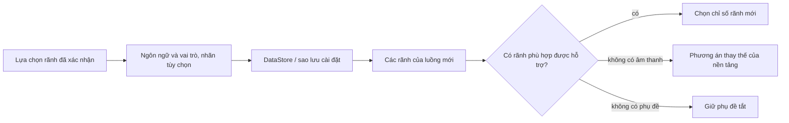

<div lang="vi" dir="ltr">

# Tùy chọn âm thanh và phụ đề được lưu lâu dài

<!-- language-navigation:start -->
<p dir="ltr">
<a href="TRACK-PREFERENCES.md" lang="en" dir="ltr">English</a> · <a href="TRACK-PREFERENCES.ar.md" lang="ar" dir="rtl">العربية</a> · <a href="TRACK-PREFERENCES.bn.md" lang="bn" dir="ltr">বাংলা</a> · <a href="TRACK-PREFERENCES.cs.md" lang="cs" dir="ltr">Čeština</a> · <a href="TRACK-PREFERENCES.de.md" lang="de" dir="ltr">Deutsch</a> · <a href="TRACK-PREFERENCES.es.md" lang="es" dir="ltr">Español</a> · <a href="TRACK-PREFERENCES.fa.md" lang="fa" dir="rtl">فارسی</a> · <a href="TRACK-PREFERENCES.fr.md" lang="fr" dir="ltr">Français</a><br>
<a href="TRACK-PREFERENCES.he.md" lang="he" dir="rtl">עברית</a> · <a href="TRACK-PREFERENCES.hi.md" lang="hi" dir="ltr">हिन्दी</a> · <a href="TRACK-PREFERENCES.id.md" lang="id" dir="ltr">Bahasa Indonesia</a> · <a href="TRACK-PREFERENCES.it.md" lang="it" dir="ltr">Italiano</a> · <a href="TRACK-PREFERENCES.ja.md" lang="ja" dir="ltr">日本語</a> · <a href="TRACK-PREFERENCES.ko.md" lang="ko" dir="ltr">한국어</a> · <a href="TRACK-PREFERENCES.nl.md" lang="nl" dir="ltr">Nederlands</a> · <a href="TRACK-PREFERENCES.pl.md" lang="pl" dir="ltr">Polski</a><br>
<a href="TRACK-PREFERENCES.pt.md" lang="pt" dir="ltr">Português</a> · <a href="TRACK-PREFERENCES.ru.md" lang="ru" dir="ltr">Русский</a> · <a href="TRACK-PREFERENCES.th.md" lang="th" dir="ltr">ไทย</a> · <a href="TRACK-PREFERENCES.tr.md" lang="tr" dir="ltr">Türkçe</a> · <a href="TRACK-PREFERENCES.uk.md" lang="uk" dir="ltr">Українська</a> · <a href="TRACK-PREFERENCES.vi.md" lang="vi" dir="ltr">Tiếng Việt</a> · <a href="TRACK-PREFERENCES.zh-Hans.md" lang="zh-Hans" dir="ltr">简体中文</a> · <a href="TRACK-PREFERENCES.zh-Hant.md" lang="zh-Hant" dir="ltr">繁體中文</a>
</p>
<!-- language-navigation:end -->

[README](../README.md)

Trong trình phát Android gốc, mở **Thêm → Âm thanh / Phụ đề**. Lựa chọn đã xác nhận được lưu theo ngôn ngữ và vai trò, không phải chỉ số trong bản kê khai. Kênh mới có thể sắp xếp lại các rãnh mà không thay đổi ngôn ngữ yêu cầu. Nhãn chỉ được dùng khi rãnh không có ngôn ngữ. Rãnh không có ngôn ngữ, nhãn lẫn vai trò chỉ được chọn cho luồng hiện tại.

- **Tự động** xóa tùy chọn chỉ định và khôi phục cách chọn của nền tảng Media3, bao gồm ngôn ngữ thiết bị. Xác nhận Tự động cũng xóa tùy chọn có ngôn ngữ không xuất hiện trong luồng hiện tại.
- **Tắt** giữ phụ đề ở trạng thái tắt qua các lần chuyển kênh và khởi động lại.
- Nếu không có âm thanh yêu cầu, Media3 chọn một phương án thay thế có thể phát. Tùy chọn đã lưu vẫn được giữ cho luồng phù hợp tiếp theo.
- Nếu không có phụ đề yêu cầu, phụ đề tiếp tục tắt. Chúng xuất hiện trở lại khi một luồng sau có ngôn ngữ và vai trò yêu cầu.
- Lựa chọn chỉ định được đưa vào bản sao lưu cài đặt. Bản sao lưu tạo trước tính năng này dùng Tự động cho cả hai loại rãnh. Kiểm tra nhập dữ liệu từ chối tùy chọn sai định dạng trước khi ghi vào kho nguồn hoặc danh mục.



Các danh mục tài nguyên Android hiện có và hộp thoại chọn rãnh đã bản địa hóa của Media3 cung cấp nhãn; tính năng này không thêm thông báo giao diện chỉ có tiếng Anh. Hộp thoại áp dụng lựa chọn đã xác nhận cho bộ điều khiển và phát ra một hành động ứng dụng; ViewModel ghi lựa chọn trong phạm vi riêng, nên đóng bảng không hủy việc lưu. Dịch vụ áp dụng các tùy chọn đã lưu. Sự kiện tự động của bộ giải mã không bao giờ ghi đè tùy chọn đã lưu.

Lựa chọn tạm thời của rãnh không có nhãn được ưu tiên cho mục phương tiện hiện tại, ngay cả khi một lần ghi tùy chọn cũ hơn hoặc thay đổi phụ đề không liên quan đến sau. Chọn rõ Tự động hoặc rãnh khác sẽ xóa lựa chọn tạm thời đó. Chuyển mục phương tiện luôn làm nó hết hiệu lực, kể cả khi luồng kế tiếp công bố nhóm rãnh tương đương. Giải phóng trình phát cũng hủy việc theo dõi tùy chọn.

## Kiểm tra

```sh
./gradlew :app:testDebugUnitTest --tests '*TrackPreferencesTest' --tests '*TrackPreferencePlayerTest' --tests '*SettingsBackupPolicyTest' :app:assembleDebug
```

Các bài kiểm tra bao gồm thay đổi thứ tự rãnh, vai trò bình luận, phụ đề biến mất rồi trở lại, Tắt/Tự động, xác nhận tùy chọn đến muộn, chuyển mục phương tiện có nhóm tương đương, giải phóng trình phát, xuất rồi nhập lại cài đặt và nhập sai định dạng. Trên thiết bị, chọn ngôn ngữ âm thanh và phụ đề, chuyển sang luồng có thứ tự rãnh đảo ngược, khởi động lại ứng dụng, rồi thử luồng không có các rãnh đó và chọn Tự động. Việc kiểm tra phát trên thiết bị thật này vẫn cần thiết; kiểm thử đơn vị không chứng minh siêu dữ liệu của nhà cung cấp luồng là chính xác.

</div>
