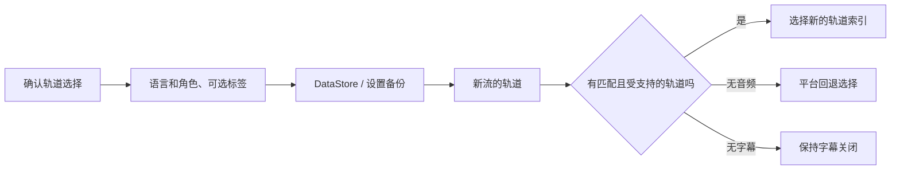

<div lang="zh-Hans" dir="ltr">

# 持久保存音频和字幕偏好

<!-- language-navigation:start -->
<p dir="ltr">
<a href="TRACK-PREFERENCES.md" lang="en" dir="ltr">English</a> · <a href="TRACK-PREFERENCES.ar.md" lang="ar" dir="rtl">العربية</a> · <a href="TRACK-PREFERENCES.bn.md" lang="bn" dir="ltr">বাংলা</a> · <a href="TRACK-PREFERENCES.cs.md" lang="cs" dir="ltr">Čeština</a> · <a href="TRACK-PREFERENCES.de.md" lang="de" dir="ltr">Deutsch</a> · <a href="TRACK-PREFERENCES.es.md" lang="es" dir="ltr">Español</a> · <a href="TRACK-PREFERENCES.fa.md" lang="fa" dir="rtl">فارسی</a> · <a href="TRACK-PREFERENCES.fr.md" lang="fr" dir="ltr">Français</a><br>
<a href="TRACK-PREFERENCES.he.md" lang="he" dir="rtl">עברית</a> · <a href="TRACK-PREFERENCES.hi.md" lang="hi" dir="ltr">हिन्दी</a> · <a href="TRACK-PREFERENCES.id.md" lang="id" dir="ltr">Bahasa Indonesia</a> · <a href="TRACK-PREFERENCES.it.md" lang="it" dir="ltr">Italiano</a> · <a href="TRACK-PREFERENCES.ja.md" lang="ja" dir="ltr">日本語</a> · <a href="TRACK-PREFERENCES.ko.md" lang="ko" dir="ltr">한국어</a> · <a href="TRACK-PREFERENCES.nl.md" lang="nl" dir="ltr">Nederlands</a> · <a href="TRACK-PREFERENCES.pl.md" lang="pl" dir="ltr">Polski</a><br>
<a href="TRACK-PREFERENCES.pt.md" lang="pt" dir="ltr">Português</a> · <a href="TRACK-PREFERENCES.ru.md" lang="ru" dir="ltr">Русский</a> · <a href="TRACK-PREFERENCES.th.md" lang="th" dir="ltr">ไทย</a> · <a href="TRACK-PREFERENCES.tr.md" lang="tr" dir="ltr">Türkçe</a> · <a href="TRACK-PREFERENCES.uk.md" lang="uk" dir="ltr">Українська</a> · <a href="TRACK-PREFERENCES.vi.md" lang="vi" dir="ltr">Tiếng Việt</a> · <a href="TRACK-PREFERENCES.zh-Hans.md" lang="zh-Hans" dir="ltr">简体中文</a> · <a href="TRACK-PREFERENCES.zh-Hant.md" lang="zh-Hant" dir="ltr">繁體中文</a>
</p>
<!-- language-navigation:end -->

[README](../README.md)

在原生 Android 播放器中打开 **更多 → 音频 / 字幕**。确认后的选择按语言和角色保存，而不是按清单中的索引保存。新频道可以重新排列轨道，而不会改变所请求的语言。只有轨道没有语言信息时才使用标签。没有语言、标签和角色的轨道，其选择仅对当前流有效。

- **自动** 会移除显式偏好，并恢复 Media3 的平台选择，包括设备语言。确认“自动”也会清除当前流中不存在的语言偏好。
- **关闭** 会在切换频道和重启后继续禁用字幕。
- 如果没有所请求的音频，Media3 会选择可播放的替代轨道。已保存的偏好仍会保留，供下一个匹配的流使用。
- 如果没有所请求的字幕，字幕将保持禁用。当后续流包含所请求的语言和角色时，字幕会恢复。
- 显式选择会包含在设置备份中。在此功能推出前创建的备份，对两种轨道类型均使用“自动”。导入校验会在写入源存储或目录之前拒绝格式错误的偏好。



标签由现有的 Android 资源目录和 Media3 本地化轨道对话框提供；此功能不会添加仅有英文的界面消息。对话框将确认后的选择应用于控制器，并发出应用操作；ViewModel 在自己的作用域内写入，因此关闭面板不会取消持久保存。服务负责应用已保存的偏好。解码器的自动事件绝不会覆盖已保存的偏好。

对无标签轨道的临时指定在当前媒体项中具有优先权，即使随后到达较早的偏好写入或无关的字幕更改也不例外。显式选择“自动”或其他轨道会移除该临时指定。媒体项切换总会使其失效，即使下一个流声明了相等的轨道组。释放播放器也会取消对偏好的观察。

## 验证

```sh
./gradlew :app:testDebugUnitTest --tests '*TrackPreferencesTest' --tests '*TrackPreferencePlayerTest' --tests '*SettingsBackupPolicyTest' :app:assembleDebug
```

测试覆盖轨道重新排序、解说角色、字幕消失与恢复、关闭/自动、延迟到达的偏好确认、具有相等轨道组的媒体项切换、播放器释放、设置导出后重新导入，以及格式错误的导入。在设备上选择音频语言和字幕，切换到轨道顺序相反的流，重启应用，然后尝试不含这些轨道的流并选择“自动”。仍然需要这项真机播放检查；单元测试无法证明流提供方的元数据正确。

</div>
