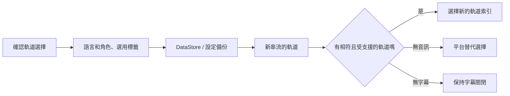

<div lang="zh-Hant" dir="ltr">

# 持續儲存音訊與字幕偏好

<!-- language-navigation:start -->
<p dir="ltr">
<a href="TRACK-PREFERENCES.md" lang="en" dir="ltr">English</a> · <a href="TRACK-PREFERENCES.ar.md" lang="ar" dir="rtl">العربية</a> · <a href="TRACK-PREFERENCES.bn.md" lang="bn" dir="ltr">বাংলা</a> · <a href="TRACK-PREFERENCES.cs.md" lang="cs" dir="ltr">Čeština</a> · <a href="TRACK-PREFERENCES.de.md" lang="de" dir="ltr">Deutsch</a> · <a href="TRACK-PREFERENCES.es.md" lang="es" dir="ltr">Español</a> · <a href="TRACK-PREFERENCES.fa.md" lang="fa" dir="rtl">فارسی</a> · <a href="TRACK-PREFERENCES.fr.md" lang="fr" dir="ltr">Français</a><br>
<a href="TRACK-PREFERENCES.he.md" lang="he" dir="rtl">עברית</a> · <a href="TRACK-PREFERENCES.hi.md" lang="hi" dir="ltr">हिन्दी</a> · <a href="TRACK-PREFERENCES.id.md" lang="id" dir="ltr">Bahasa Indonesia</a> · <a href="TRACK-PREFERENCES.it.md" lang="it" dir="ltr">Italiano</a> · <a href="TRACK-PREFERENCES.ja.md" lang="ja" dir="ltr">日本語</a> · <a href="TRACK-PREFERENCES.ko.md" lang="ko" dir="ltr">한국어</a> · <a href="TRACK-PREFERENCES.nl.md" lang="nl" dir="ltr">Nederlands</a> · <a href="TRACK-PREFERENCES.pl.md" lang="pl" dir="ltr">Polski</a><br>
<a href="TRACK-PREFERENCES.pt.md" lang="pt" dir="ltr">Português</a> · <a href="TRACK-PREFERENCES.ru.md" lang="ru" dir="ltr">Русский</a> · <a href="TRACK-PREFERENCES.th.md" lang="th" dir="ltr">ไทย</a> · <a href="TRACK-PREFERENCES.tr.md" lang="tr" dir="ltr">Türkçe</a> · <a href="TRACK-PREFERENCES.uk.md" lang="uk" dir="ltr">Українська</a> · <a href="TRACK-PREFERENCES.vi.md" lang="vi" dir="ltr">Tiếng Việt</a> · <a href="TRACK-PREFERENCES.zh-Hans.md" lang="zh-Hans" dir="ltr">简体中文</a> · <a href="TRACK-PREFERENCES.zh-Hant.md" lang="zh-Hant" dir="ltr">繁體中文</a>
</p>
<!-- language-navigation:end -->

[README](../README.md)

在原生 Android 播放器中開啟 **更多 → 音訊 / 字幕**。確認後的選擇是依語言和角色儲存，而不是依資訊清單中的索引儲存。新頻道可以重新排列軌道，而不改變要求的語言。只有軌道沒有語言資訊時才使用標籤。沒有語言、標籤和角色的軌道，其選擇只對目前的串流有效。

- **自動** 會移除明確指定的偏好，並恢復 Media3 的平台選擇，包括裝置語言。確認「自動」也會清除目前串流中不存在的語言偏好。
- **關閉** 會在切換頻道與重新啟動後持續停用字幕。
- 若沒有要求的音訊，Media3 會選擇可播放的替代軌道。已儲存的偏好仍會保留，供下一個相符的串流使用。
- 若沒有要求的字幕，字幕會保持停用。當後續串流包含要求的語言和角色時，字幕會恢復。
- 明確指定的選擇會包含在設定備份中。在這項功能推出前建立的備份，對兩種軌道類型皆使用「自動」。匯入驗證會在寫入來源儲存區或目錄之前拒絕格式錯誤的偏好。



標籤由現有的 Android 資源目錄及 Media3 的本地化軌道對話框提供；這項功能不會新增只有英文的介面訊息。對話框將確認後的選擇套用至控制器，並發出應用程式動作；ViewModel 在自己的作用域內寫入，因此關閉面板不會取消持續儲存。服務負責套用已儲存的偏好。解碼器的自動事件絕不會覆寫已儲存的偏好。

對無標籤軌道的暫時指定在目前媒體項目中具有優先權，即使之後收到較早的偏好寫入或無關的字幕變更也不例外。明確選擇「自動」或其他軌道會移除該暫時指定。媒體項目切換一律會使其失效，即使下一個串流宣告了相等的軌道群組。釋放播放器也會取消對偏好的觀察。

## 驗證

```sh
./gradlew :app:testDebugUnitTest --tests '*TrackPreferencesTest' --tests '*TrackPreferencePlayerTest' --tests '*SettingsBackupPolicyTest' :app:assembleDebug
```

測試涵蓋軌道重新排序、解說角色、字幕消失與恢復、關閉/自動、延遲收到的偏好確認、具有相等軌道群組的媒體項目切換、播放器釋放、設定匯出後重新匯入，以及格式錯誤的匯入。在裝置上選擇音訊語言和字幕，切換至軌道順序相反的串流，重新啟動應用程式，接著嘗試不含這些軌道的串流並選擇「自動」。仍然需要這項實機播放檢查；單元測試無法證明串流供應者的中繼資料正確。

</div>
